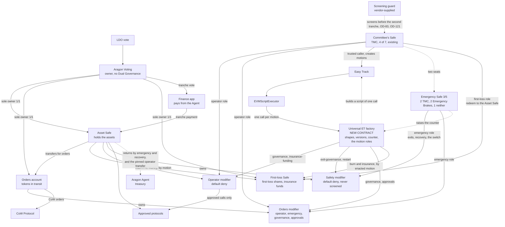

# LIP-XX: Active Treasury Management Vault

| LIP field | Value |
|---|---|
| lip | to be assigned |
| title | Active Treasury Management Vault |
| status | WIP |
| author | to be filled by proposers |
| discussions-to | a thread on https://research.lido.fi/, to be created |
| created | 2026-09-22 |

> **Skeleton.** The [ADRs](/adr/index.md) govern this draft [s2]. Until phase 4 of the [roadmap](https://github.com/lidofinance/clutch/blob/main/ROADMAP.md), each part states its subject in a few sentences and points to the pages that own it, so that the draft cannot drift from them. Nothing is deployed to mainnet. No audit has been performed.

> **Status labels.** **[Implemented]** means built and tested against deployed bytecode on a pinned mainnet fork. **[Specified]** means designed but unbuilt. **[Decided]** means EM decided it and it needs no new code from Lido. **[Open]** means a decision is required.

## Simple Summary

The Treasury Management Committee can use a bounded part of the DAO treasury in approved DeFi protocols. The DAO keeps ownership; neither the committee nor a service provider can take the assets.
On-chain permissions limit the committee's actions. An emergency Safe can return assets and disable the operator. No emergency body can restart what it stopped; an Easy Track motion restarts the operator (OD-104).
One Easy Track factory carries every Clutch motion: it onboards and removes strategies, sets budgets and ceilings, and runs the insurance funds (OD-102). The emergency Safe can revoke a permission at once (OD-70).
Aragon votes fund the vault in rare tranches (OD-106). After the enabling vote, no administrative action needs an Aragon vote (OD-101).

## Abstract

Aragon Voting owns the vault's Safes, so no vault action passes Dual Governance (OD-73). On the Asset Safe, two Zodiac Roles modifiers enforce default-deny permissions: the committee's Safe acts as the operator, and a three-of-five emergency Safe holds the exits, recovery and the switch. All swaps are CoW orders from a dedicated orders account, and each role's permissions pin the receiver. One universal Easy Track factory, with a thin companion contract, carries every motion and is the only new code (OD-102, OD-117); CoW's order signer counts as new code with it (OD-96). Aragon Voting funds the vault in rare tranches through Finance (OD-106). Insurance for earnETH, earnUSD and Lido Lend ships at launch (OD-107), and funds go back to the Aragon Agent only through emergency and recovery paths (OD-108) [s1].

## Motivation

### Background

The DAO treasury holds idle assets. A [Treasury Management Committee](https://docs.lido.fi/multisigs/committees#25-treasury-management-committee) exists and, by the principles under which it was formed, never takes custody. Putting treasury assets to work therefore requires a system where the committee can transact but cannot possess, and where the DAO can reverse any of it.

### Problem

Three properties are needed at once and no existing Lido component provides them together.

1. **Custody must stay with the DAO.** The DAO must remain the only owner of the vault, through Aragon Voting (OD-73), and recovered assets go to the Aragon Agent, the DAO's treasury. No provider outage, suspension, or contract termination may change that.
2. **Authority must be bounded before execution, not after.** A report-and-remediate control does not stop a transaction. The system must deny unapproved targets, functions, and parameters at execution time.
3. **Routine changes must not require a full DAO vote, and must still not be arbitrary.** Adding an approved strategy should be an Easy Track motion with an objection window. That motion must not be able to widen authority beyond what the DAO already approved.

A conventional multisig fails the second property. A provider-operated vault fails the first. Granting Easy Track general execution authority over the Agent fails the third, because it would let a motion forward any script as the Agent and would put the entire treasury behind a three-day objection window.

### Solution

Separate **custody**, **authority** and **change control** into three layers that are already audited, and add only the new code that change control needs.

- Custody: Safes owned one of one by Aragon Voting (OD-73).
- Authority: Zodiac Roles modifiers enabled as modules on those Safes, with each Safe as its modifiers' owner.
- Change control: Easy Track motions through one universal factory. It widens a permission only through typed shapes fixed at audit time, and a raw write only narrows (OD-102).

Funding needs no new contract: Aragon Voting pays each tranche through the Finance application (OD-106).

## Specification

### Overview

Each role executes **as the Safe** through `execTransactionFromModule`, after the modifier checks its permissions.

### Rationale

The ADRs hold the rationale of each choice, with the options that were not chosen [s2].

### Technical Specification

#### Part 1: Account graph **[Implemented in part]**

Aragon Voting owns, one of one, the Asset Safe, which holds the assets; the orders account, which holds tokens in transit for CoW orders; and the first-loss Safe, which holds the DAO's first-loss Earn shares and the insurance money. These three and the three-of-five emergency Safe run Safe v1.5.0, and the committee's existing four-of-seven Safe on v1.3.0 is the operator. Owner: [ADR 005](/adr/005-account-graph-and-roles.md). The fork suite deploys every account; the first-loss modifier's policy is not built.

#### Part 2: Roles and authority **[Implemented in part]**

The committee's Safe holds `operator` and `first-loss`. The emergency Safe holds `emergency`, with the switch. The universal factory holds every motion role, and the Emergency Brakes multisig holds no role in the vault (OD-58, OD-118). Owners: [ADR 005](/adr/005-account-graph-and-roles.md), and [ADR 013](/adr/013-one-easy-track-factory.md) decision 18 for the motion roles; INV-018, INV-026, INV-027 and INV-032 check them.

#### Part 3: Permission encoding **[Implemented]**

Each Roles modifier refuses every call that its policy does not list: default deny. The policy is a Zodiac constellation in TypeScript. Clutch's compiler turns it into one committed artifact of modifier calls, trees and allowances, and CI refuses an artifact that differs from a fresh compile. Owners: [ADR 004](/adr/004-specifications-and-policy-as-data.md) and the [specification policy](/specs/specification-policy.md).

#### Part 4: Governance — the new contracts **[Implemented in part]**

A motion's script is one call, the universal factory's `applyMotion`, which checks the motion again and makes its writes (OD-118). The factory widens only through typed shapes, keeps a version for each scope and a counter that the emergency Safe raises, bounds the ceilings, and restarts and restores after a stop. Owners: [ADR 006](/adr/006-governance-through-easy-track-factories.md) and [ADR 013](/adr/013-one-easy-track-factory.md), whose proposed direction lists the shapes. The prototype builds the factory's core and its approval-list, budget, ceiling, introduction, restore, restart, insurance-money and orders operations; the burn, insurance-fund and Morpho Blue shapes are not built.

#### Part 5: Funding and insurance **[Implemented in part]**

Aragon Voting funds the vault in rare tranches through Finance, and the first tranche, inside the enabling vote, is the launch cap. Insurance for earnETH, earnUSD and Lido Lend is built in at launch, with its money from the Asset Safe by motion. Owners: [ADR 014](/adr/014-funding-by-tranche-votes.md) and [ADR 008](/adr/008-funding-through-existing-payments.md). The fork suite pays the first and a later tranche and moves insurance money; the fund shapes are not built.

#### Part 6: Emergency response **[Implemented in part]**

The emergency Safe revokes operator permissions at once, disables the operator modifier with the switch, raises the factory's counter, cancels and sweeps orders, and sells into USDC or USDT through recovery orders that pay the Aragon Agent. No emergency body resumes what it stopped: a restart motion and a restore motion do, after their objection window. Owners: [ADR 005](/adr/005-account-graph-and-roles.md), [ADR 007](/adr/007-swapping-through-an-orders-account.md) and [ADR 013](/adr/013-one-easy-track-factory.md) decision 12; the [runbooks](/runbooks/index.md) and their drills are owed.

#### Part 7: Budgets **[Implemented]**

Each protocol spender has a budget key that its approvals spend. Ceilings bound the keys; a motion lowers one at any time and raises it at most twofold in 15 days. Owners: [ADR 009](/adr/009-budgets-caps-reporting-and-monitoring.md) and [ADR 013](/adr/013-one-easy-track-factory.md) decision 13. The figures wait for the attested computation.

#### Part 8: Launch asset and action matrix **[Implemented in part]**

[ADR 011](/adr/011-launch-scope.md) holds the launch list, the role of each asset and the integrations outside the launch. The policy covers the launch scope and refuses the venues outside it (INV-015); Lido Lend joins later by motion, through a shape that is not built.

#### Part 9: Reporting and detective controls **[Specified]**

The caps are detective. Lido's report generator and the policy provider's reading publish fortnightly cap readings, both count, and a breach that gets worse triggers the switch. [ADR 009](/adr/009-budgets-caps-reporting-and-monitoring.md) and the [control matrix](/specs/control-matrix.md) hold the reports, the price waterfall and the detectors, and [ADR 010](/adr/010-pre-execution-screening.md) holds screening. When the LIP is published, this part states the price waterfall of ADR 009 decisions 35 to 37, because the mandate's text leaves it to the LIP (OD-90). Nothing in this part is built.

### Test Cases

The fork suite runs against deployed bytecode on a pinned mainnet fork. The [invariants](/specs/invariants.md) name the tests of each property, and the harness README in `test/` lists the suites.

## Configuration

### Parameters

The [parameters register](/registers/parameters.md) holds every parameter with its value and state. The figures enter when the mandate is approved.

### Roles and Authority

[ADR 005](/adr/005-account-graph-and-roles.md) holds the role table: each role, its holder and its modifier.

## Security Considerations

- **Composition is the primary risk.** Each component is audited separately; the composition, a Safe that owns the modifier that administers it, is what an audit must cover: whether any role reaches an owner-only surface, directly or through a permission granted to another role ([ADR 006](/adr/006-governance-through-easy-track-factories.md) decision 10).
- **Execution options.** A delegatecall from the Asset Safe runs foreign code in the Safe's storage, so a motion grants only None or Send there; on the orders account it grants delegatecall only to CoW's order signer (OD-36, OD-103).
- **The factory is the widening surface.** A shape flaw is reachable by any motion that survives its objection window, and the exit shapes write the unscreened emergency path. A motion can select a contract that no audit covered; the shapes limit the interactions, and the budget limits the loss ([ADR 006](/adr/006-governance-through-easy-track-factories.md), [ADR 013](/adr/013-one-easy-track-factory.md)).
- **First ceilings.** A token's introduction sets its first ceilings, which only the objection window bounds; the introduction counts as the first raise, so the next raise waits 15 days (OD-113, OD-120).
- **One call per motion.** A motion's script shows one call, so reviewers read the factory's `writesOf` for the writes that it makes (OD-118).
- **Replacement semantics.** A write replaces a permission slot, so every shape and raw write emits a complete tree (OD-102).
- **Orders.** The orders account holds tokens in transit, and nothing on chain bounds an order's price: CoW's competition and EBBO rule, screening, budgets and fill monitoring are the controls (OD-48) [s11].
- **Safe v1.5.0 has a short record.** It is audited and formally verified on the vault's main paths, but it has held little value for a short time. The Asset Safe uses no fallback handler and no contract signature; the orders account does, and holds only tokens in transit. Releases and advisories are checked again before the enabling vote (OD-17) [s8].
- **Weak amount controls.** Lido-product budget keys allow the whole mandate per month, and the caps are detective: the policy cannot see value ([ADR 009](/adr/009-budgets-caps-reporting-and-monitoring.md)).
- **Screening.** The vendor's guard can stop operator activity and motion creation; recovery never depends on it, and the owners can remove it after ten days ([ADR 010](/adr/010-pre-execution-screening.md)).
- **Stale motions.** A motion that fails at enactment holds one of Easy Track's 20 shared open-motion slots until it is cancelled (OD-94).
- **Flows out of the vault.** Funds leave only to the Aragon Agent, through emergency and recovery paths and the operator's pinned return, and to an insurance fund's pinned payout address within its cap (OD-107, OD-108).
- **Encoding and provenance.** Until the round-trip check of phase 2 exists, nothing independent checks the encoding on chain. Before funding, every reused component is verified against a locally compiled tagged release.

## Failure Modes

The [threat model](/specs/threat-model.md) lists the failure modes, each with its trigger, its mitigation and its detection.

## Open Items

The [open-decisions register](/registers/open-decisions.md) tracks every open item. These can change this proposal:

1. **The emergency Safe's fifth signer.** A Snapshot appoints a member of neither the committee nor the Emergency Brakes multisig (OD-58); who holds the seat is open (OD-65).
2. **The mandate's owed text.** The [enabling vote](/specs/enabling-vote.md) lists it (OD-90).
3. **Twyne.** Its holder and form must be shown before it counts ([ADR 008](/adr/008-funding-through-existing-payments.md) decision 17).
4. **The vendor's confirmations.** The vendor confirms in writing that it accepts the exclusion of standing approvals, before the second tranche's vote, and that it agrees to be named, before the mandate is posted ([ADR 010](/adr/010-pre-execution-screening.md) decisions 9 and 13).

## Links

- Zodiac Roles modifier, deployed mastercopy: `0xF2964CE6161ce0e75964Fe7927cE114cb0B283D5`
- Safe smart account v1.5.0 release: https://github.com/safe-fndn/safe-smart-account/releases/tag/v1.5.0
- Easy Track: https://docs.lido.fi/deployed-contracts/#easy-track
- CoW Protocol, ComposableCoW: https://docs.cow.fi/cow-protocol/reference/contracts/periphery/composable-cow
- Treasury Management Committee: https://docs.lido.fi/multisigs/committees#25-treasury-management-committee
- Emergency Brakes: https://docs.lido.fi/multisigs/emergency-brakes#12-emergency-brakes-ethereum

## Copyright

Copyright and related rights waived via [CC0](https://creativecommons.org/publicdomain/zero/1.0/).
