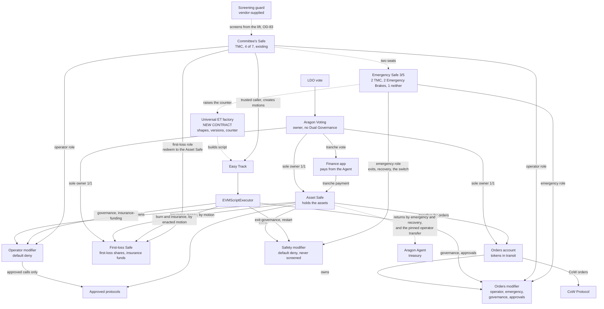

# LIP-XX: Active Treasury Management Vault

| LIP field | Value |
|---|---|
| lip | to be assigned |
| title | Active Treasury Management Vault |
| status | WIP |
| author | to be filled by proposers |
| discussions-to | a thread on https://research.lido.fi/, to be created |
| created | 2026-09-22 |

> **Draft.** Written during the design review of 2026-09-10 to 2026-09-22; imported on 2026-09-30. The [ADRs](/adr/index.md) govern this draft [s2]. Chain facts used by the ADRs were re-read at block 26092572 [s3]. The Easy Track and Finance facts of Parts 4 and 5 were read at block 26350608 [s17]. Other chain claims come from the design review and were not re-run. Part 5 records the funding and insurance decisions (OD-89, OD-106, OD-107), and section 9.1 the screening decisions (OD-54, OD-83). See [open decisions](/registers/open-decisions.md).

> **Status labels.** **[Implemented]** means built and tested against deployed bytecode on a pinned mainnet fork. **[Specified]** means designed but unbuilt. **[Decided]** means EM decided it and it needs no new code from Lido. **[Open]** means a decision is required. Nothing is deployed to mainnet. No audit has been performed.

## Simple Summary

The Treasury Management Committee can use a bounded part of the DAO treasury in approved DeFi protocols. The DAO keeps ownership; neither the committee nor a service provider can take the assets.
On-chain permissions limit the committee's actions. An emergency Safe can return assets and disable the operator. No emergency body can restart what it stopped; an Easy Track motion restarts the operator (OD-104).
One Easy Track factory carries every Clutch motion: it onboards and removes strategies, sets budgets and ceilings, and runs the insurance funds (OD-102). The emergency Safe can revoke a permission at once (OD-70).
Aragon votes fund the vault in rare tranches (OD-106). After the enabling vote, no administrative action needs an Aragon vote (OD-101).

## Abstract

Aragon Voting is the sole owner of the Asset Safe (OD-73).
On the Asset Safe, two Zodiac Roles modifiers enforce default-deny permissions:

- The operator modifier carries `operator`, held by the committee's Safe, and two roles of the Easy Track executor: `governance` and `insurance-funding`.
- The safety modifier carries `emergency`, held by a new three-of-five Safe: two committee members, two Emergency Brakes members and one member of neither body. It also carries two roles of the Easy Track executor: exit governance, which adds an emergency exit, and `restart`, which may only enable the operator modifier again (OD-49, OD-104).

The committee cannot form the emergency quorum alone. The Emergency Brakes multisig retains only the global Easy Track pause and touches no funds.
No emergency body can restart what it stopped. A motion restarts the operator, after the objection window.

All swaps use CoW orders from a dedicated account owned by Aragon Voting.
Each role's permissions pin the receiver: the Asset Safe for operator orders, the Agent for recovery orders.
Prices have no on-chain bound. CoW's competition rules, screening, budgets and fill monitoring provide the controls.

One universal Easy Track factory carries every motion (OD-102).
Its Easy Track registration is its address book: `execTransactionWithRole` on the vault's four modifiers, and its own `commit`.
It widens a permission only through typed shapes. Each shape pins receivers to the vault, draws a budget key and writes the emergency exit. A raw write only narrows.
Versions stop two motions from overwriting each other. A counter lets the emergency Safe make every open motion fail.
Routine removal is a narrowing motion. Emergency removal uses immediate revocation.

The universal factory is the only new contract. CoW's order signer has no known audit, so it counts as new code with the factory (OD-96).
No bespoke access-control, vault or accounting contract is introduced.

Aragon Voting funds the vault in tranches. Each tranche is a vote that pays the Asset Safe through the existing Finance application, without Dual Governance (OD-106). The first tranche, one million dollars, is an item of the enabling vote and is the launch cap.
Insurance for earnETH, earnUSD and Lido Lend ships at launch. Its money comes from the Asset Safe by motion (OD-107).
Funds go back to the Aragon Agent only through emergency and recovery paths (OD-108).

## Motivation

### Background

The DAO treasury holds idle assets. A [Treasury Management Committee](https://docs.lido.fi/multisigs/committees#25-treasury-management-committee) exists and, by the principles under which it was formed, never takes custody. Putting treasury assets to work therefore requires a system where the committee can transact but cannot possess, and where the DAO can reverse any of it.

### Problem

Three properties are needed at once and no existing Lido component provides them together.

1. **Custody must stay with the DAO.** The DAO must remain the only owner of the vault, through Aragon Voting (OD-73), and recovered assets go to the Aragon Agent, the DAO's treasury. No provider outage, suspension, or contract termination may change that.
2. **Authority must be bounded before execution, not after.** A report-and-remediate control does not stop a transaction. The system must deny unapproved targets, functions, and parameters at execution time.
3. **Routine changes must not require a full DAO vote, and must still not be arbitrary.** Adding an approved strategy should be an Easy Track motion with an objection window. That motion must not be able to widen authority beyond what the DAO already approved.

A conventional multisig fails the second property. A provider-operated vault fails the first. Granting Easy Track general execution authority over the Agent fails the third, because it would let a motion forward any script as the Agent and would put the entire treasury behind a three-day objection window.

### Solution

Separate **custody**, **authority**, and **change control** into three layers that are already audited, and add only one new contract: the Easy Track factory that change control needs.

- Custody: a Safe owned one-of-one by Aragon Voting (OD-73).
- Authority: two Zodiac Roles modifiers enabled as modules on that Safe, with the Safe as their owner.
- Change control: Easy Track motions through one universal factory. It widens a permission only through typed shapes fixed at audit time, and a raw write only narrows (OD-102).

Funding needs no new contract: Aragon Voting pays each tranche through the Finance application (OD-106).

## Specification

### Overview



Each role executes **as the Safe** through `execTransactionFromModule`, after the modifier checks its permissions.

### Rationale

**Modifier ownership.** A role executes with the Safe avatar's authority.
The Safe owns its modifiers, so scoped roles can administer them without a DAO vote: emergency revokes the operator in minutes, and governance changes policy by motion.

**No Easy Track authority over the Agent.** At block 26092572, only the Dual Governance admin executor holds the Agent's `RUN_SCRIPT_ROLE` and `EXECUTE_ROLE` [s3].
Giving either to Easy Track would let motions forward arbitrary Agent scripts.
The governance role supplies only the required modifier authority.

**Typed shapes, not trees.** A permission write replaces the entire role/target/selector slot.
The Roles modifier keeps its trees in internal storage, so no contract can read them [s17].
A tree that a motion supplies could therefore widen a permission, unless a check proves it narrower.
The universal factory widens a permission only through typed shapes, such as a vault with its asset, and builds complete trees from them.
The audit covers that finite set of shapes.
A raw write may only narrow (OD-102). As proposed, it names the scope's current content, which must match the scope's version, and writes a subset of it [s15].

**Versions, not Merkle roots.** Easy Track motions have no order. Two motions that write one scope both pass their checks, and the later enactment wins [s17].
The factory therefore keeps a version for each scope. It checks the versions at creation and again at enactment, and the script's last call commits the new ones (OD-100, OD-102) [s15].
A Merkle-root policy would replace the Roles modifiers with new code, so Clutch uses none (OD-100) [s17].
One write of the whole policy per motion does not scale: the Asset Safe's launch batch of 99 calls already took about 6.3 million gas in the rehearsal, and EIP-7825 caps a transaction at about 16.8 million [s15].

**One bound, not two modifiers.** An alternative chained a second Roles modifier in front of the first, with bounds that only a vote changes.
It adds a modifier and a second policy to keep in sync, and each change of a bound becomes a vote.
The factory's shapes give the bound instead (OD-112) [s17].

**Few votes after launch.** After the enabling vote, no administrative action needs an Aragon vote; a motion is the most that one needs (OD-101).
Each funding tranche and the replacement of a role holder stay Aragon votes (OD-101, OD-106) [s15].
The agent reads OD-101 to keep three more votes, for break-glass and Lido-wide actions: an owner action on a vault Safe, such as a module, the Safe version or the owners; a new or changed factory; and an Easy Track unpause, which only Aragon Voting can do [s15][s17].

**Funding by tranche votes.** Funding is not regular, so each funding is an Aragon vote (OD-106).
Aragon Voting holds Finance's payment permission without parameters. It pays any token, and no Dual Governance proposal is on that path [s17].
The vault therefore needs no Easy Track funding machinery [s16].

**Emergency quorum.** The emergency role is easier to reach than the operator role. A lower quorum shortens response time for its one-way revocation, exits and returns to the Agent without widening those powers.
These powers only reduce exposure, but recovery orders can lose value: they have no on-chain price floor.
Only CoW's rules hold their fill to the on-chain market (OD-43, OD-48).

**Separate orders account.** Direct pre-signing exposes only a hash, which hides tokens, amounts and receiver from the permission layer.
CoW's order signer accepts typed orders and computes that hash, so permissions can pin tokens, receiver and life.
TWAP requires CoW's fallback handler, which the Asset Safe does not have.
The Voting-owned orders account carries the handler and holds only tokens in transit.
A motion adds a token there. Its governance role grants delegatecall only to the order signer (OD-103).

The caller chooses the order limit, so price controls depend on screening, budgets and fill monitoring.
The committee needs limit and TWAP orders, which the previous treasury swap contracts did not support (OD-43).
The launch excludes stop-loss orders (OD-79).

**Budgeted approvals.** A spender can pull funds without a deposit call, and an operator can restore an approval.
Each approval to a protocol spender spends that spender's budget key, which bounds total approvals per key per period regardless of spender behaviour (OD-08).
Each shape derives a key for its new spender, so the policy holds no spare keys (OD-102).

### Technical Specification

---

#### Part 1: Account graph **[Implemented in part]**

| Component | Address | Source |
| --- | --- | --- |
| Aragon Agent | `0x3e40D73EB977Dc6a537aF587D48316feE66E9C8c` | existing |
| Aragon ACL | `0x9895F0F17cc1d1891b6f18ee0b483B6f221b37Bb` | existing, resolved via `Agent.kernel().acl()` |
| Aragon Voting | `0x2e59A20f205bB85a89C53f1936454680651E618e` | existing. The only owner of the vault's Safes (OD-73). It holds Finance's payment permission without parameters, and Easy Track's admin, pause, unpause and cancel roles [s17] |
| Dual Governance admin executor | `0x23E0B465633FF5178808F4A75186E2F2F9537021` | existing |
| Finance application | `0xB9E5CBB9CA5b0d659238807E84D0176930753d86` | existing, `vault()` returns the Agent. Aragon Voting pays each tranche through it (OD-106) |
| Easy Track | `0xF0211b7660680B49De1A7E9f25C65660F0a13Fea` | existing. At most 20 motions are open at once, and every Lido motion shares that limit (OD-94) [s17] |
| EVMScriptExecutor | `0xFE5986E06210aC1eCC1aDCafc0cc7f8D63B3F977` | existing. Holds every role that a Clutch motion uses (Part 2) |
| **TMC multisig, the committee's Safe** | `0xa02FC823cCE0D016bD7e17ac684c9abAb2d6D647` | existing, Safe v1.3.0, threshold 4 of 7. Holds the operator role and the **first-loss** role (OD-60, OD-80), and is the trusted caller of the universal factory (OD-80, OD-102). Two of its signers sit on the Emergency Safe. It carries the screening guard before the second tranche's vote, which lifts the launch cap (OD-83, OD-106). A change of its members needs no Snapshot each time; monitoring alerts on every change of its owners or threshold (OD-109) |
| Emergency Brakes multisig | `0x73b047fe6337183A454c5217241D780a932777bD` | existing, threshold 3 of 5; holds the global Easy Track pause and no role in the vault; two of its members sit on the Emergency Safe (OD-58) |
| **Emergency Safe** | to be deployed | new Safe v1.5.0 instance, **threshold 3 of 5**: two TMC members, two Emergency Brakes members and a fifth signer who is a member of neither body. No guard. It raises the universal factory's counter at every stop (OD-102) |
| Safe singleton v1.5.0 | `0xFf51A5898e281Db6DfC7855790607438dF2ca44b` | reused. `VERSION()` returns `1.5.0`, and the runtime codehash equals `0xdda019cbd7c867a533a2a86e5c53434fdc50b13122b5a5ddb4a8df61b31c20f2`, matching the published deployment record. Released 2025-07-03, audited by Certora and Ackee at pinned commits, covered by the Safe bug-bounty programme. The Asset Safe and the Emergency Safe use v1.5.0, by EM's decisions of 2026-10-02 and 2026-10-05 [s1]; the committee's existing Safe runs v1.3.0 (OD-80). The screening vendor's guard passed the same fork suite on v1.3.0, v1.4.1 and v1.5.0 [s6]. None of the six Lido Safes checked runs v1.5.0 today. Its record of holding value is short; see Security Considerations [s8] |
| Safe proxy factory v1.5.0 | `0x14F2982D601c9458F93bd70B218933A6f8165e7b` | reused |
| Zodiac Roles mastercopy | `0xF2964CE6161ce0e75964Fe7927cE114cb0B283D5` | reused, `owner()` is `0x…01`, i.e. locked |
| Zodiac ModuleProxyFactory | `0x000000000000aDdB49795b0f9bA5BC298cDda236` | reused |
| **Asset Safe** | to be deployed | new instance of the singleton. No guard and no fallback handler are set on it. Aragon Voting, its only owner, authorizes its transactions only by `approveHash` or by sending them itself, never by a contract signature (OD-17, OD-73) |
| **Operator modifier** | to be deployed | minimal proxy of the mastercopy. Carries the operator role, held by the committee's Safe (OD-80), and two roles of the Easy Track executor: `governance` and `insurance-funding` (OD-102, OD-107) |
| **Safety modifier** | to be deployed | minimal proxy of the mastercopy. Carries the emergency role, and two roles of the Easy Track executor: exit governance, through which a motion adds an emergency exit (OD-49), and `restart`, which only enables the operator modifier again (OD-104). Never screened |
| **Screening guard** | vendor-supplied | the screening vendor's existing transaction guard, one instance, set with `setGuard` on the committee's Safe before the second tranche's vote, which lifts the launch cap (OD-83, OD-106). Not written by Lido |
| **Universal factory** | to be deployed | the only new contract: one Easy Track EVM script factory, which cannot be upgraded, with the committee's Safe as its trusted caller. Its Easy Track registration allows only `execTransactionWithRole` on the four modifiers and its own `commit`. It keeps a version for each scope and one counter (OD-100, OD-102) [s15] |
| **Orders account** | to be deployed | new Safe instance owned by Aragon Voting, one of one, with CoW's `ExtensibleFallbackHandler` at `0x2f55e8b20D0B9FEFA187AA7d00B6Cbe563605bF5` and ComposableCoW as the verifier of CoW's settlement domain. Holds only tokens in transit between a transfer and a fill. Its one modifier carries the operator and emergency roles, and the governance and approvals roles of the Easy Track executor: a motion adds a token (OD-43, OD-57, OD-58, OD-103) [s11] |
| **First-loss Safe** | to be deployed | new Safe instance owned by Aragon Voting, one of one, with no guard or fallback handler. Holds the DAO's first-loss Earn shares and the insurance funds for earnETH, earnUSD and Lido Lend (OD-107). One modifier carries **first-loss**, held by the committee's Safe, which redeems the Earn shares with the proceeds pinned to the Asset Safe (OD-60, OD-108); and **first-loss-burn** and the insurance roles, held by the EVMScriptExecutor, which act only as enacted motions (OD-67, OD-107) |
| CoW order signer | `0x23dA9AdE38E4477b23770DeD512fD37b12381FAB` | reused, verified `CowswapOrderSigner`; called by delegatecall from the orders account [s11]. It is the only delegatecall target that a motion can grant (OD-103). It has no known audit, so it counts as new code with the universal factory (OD-96) |
| ComposableCoW and its TWAP handler | `0xfdaFc9d1902f4e0b84f65F49f244b32b31013b74`, `0x6cF1e9cA41f7611dEf408122793c358a3d11E5a5` | reused; Ackee audited ComposableCoW and CoW's fallback handler, and Gnosis reviewed ComposableCoW; whether the TWAP handler is in those reports' scope is not checked [s11] |

The Emergency Safe, the orders account and the first-loss Safe are new instances of the audited Safe singleton, not new contract code. Aragon Voting owns the orders account and the first-loss Safe (OD-73). The committee's Safe is the TMC multisig itself, so no owner set needs to follow it (OD-80). A change of the committee's members needs no Snapshot each time: monitoring alerts on every change of the owners or the threshold of the committee's Safe, and a runbook covers the change (OD-109). The Emergency Safe's two TMC seats and two Emergency Brakes seats follow their bodies: a signer who leaves a body leaves the seat. That reconciliation is an operational duty with no on-chain enforcement, and an owner change on the Emergency Safe is a critical alert.

**Deployment constraints.**

1. The Roles mastercopy keeps its own storage from slot 0. Deploying it behind a Safe proxy overwrites the proxy's implementation pointer with the avatar address and bricks the instance. It **must** be deployed through the Zodiac `ModuleProxyFactory`, which produces EIP-1167 minimal proxies that hold the implementation in bytecode.
2. The deployed mastercopy predates the current upstream source. Its initialiser is `setUp(bytes)` taking `abi.encode(owner, avatar, target)`, not the three-argument form. Audits and deployment tooling must pin the deployed bytecode, not repository HEAD.
3. Each modifier's `owner`, `avatar` and `target` are its own Safe.
4. The Asset Safe is set up with no fallback handler. Without one, it refuses ERC-721 and ERC-1155 safe transfers and cannot sign a message by EIP-1271. A protocol that needs either comes back to EM (OD-17).
5. The orders account is set up with CoW's fallback handler, and its domain verifier for CoW's settlement domain is ComposableCoW. A fork rehearsal set both on a Safe v1.5.0 but placed no order [s14]. Fork tests of signed and TWAP orders must pass before the account is relied on [s11].
6. The universal factory fixes the committee's Safe as its trusted caller at deployment, and Easy Track cannot change it later [s15]. Before the enabling vote, a chain check confirms that the factory's registration lists only its address book (INV-032).

#### Part 2: Roles and authority **[Implemented in part]**

The principals and their roles follow. Role keys are `bytes32`; the encoding must match the tooling that applies the policy and is a deployment-time check.

| Role | Holder | May do | May not do |
| --- | --- | --- | --- |
| DAO | Aragon Voting, by vote, as the only owner (OD-73) | Everything: owns the Safe, may replace the whole policy, may add or remove role members; pays each funding tranche through Finance (OD-106) | — |
| `operator` | Committee's Safe, the TMC signers, screened from the lift of the launch cap. **Operator modifier** and the orders modifier | Open, adjust, and close positions in approved protocols within budgets; approve approved spenders, each approval spending its spender's budget key or staying below a ceiling (OD-08, OD-105); stake ETH; convert DAI to USDS and back through Sky's converter, pinned to the Asset Safe; fund the orders account under budgets and place CoW orders there that pay the Asset Safe (OD-43); transfer any listed token to the Aragon Agent, pinned, without a motion (OD-108) | Transfer any asset out, except into the orders account or to the Aragon Agent; borrow; create debt; administer a modifier or a Safe; change its own permissions |
| `governance` | EVMScriptExecutor, driven by Easy Track. **Operator modifier** | Write operator permissions through a typed shape of the universal factory, for a target named in a motion; narrow them by a raw write; set operator budgets and ceilings within their limits (OD-102, OD-105) | Submit a tree that widens a permission; grant or remove any role; touch the emergency role; target the modifier's avatar or any of its modules; grant delegatecall |
| `insurance-funding` | EVMScriptExecutor, driven by Easy Track. **Operator modifier** | Transfer a listed token from the Asset Safe to the first-loss Safe, only as an enacted motion (OD-107) | Pay anyone but the first-loss Safe |
| `emergency` | Emergency Safe, three of five: two TMC members, two Emergency Brakes members and one member of neither body. **Safety modifier** and the orders modifier | Set approvals to zero; exit positions to the Safe; unwrap wstETH and WETH, stake ETH and redeem sUSDS; transfer assets to the Agent or to the orders account; on the orders account, cancel orders, set a relayer approval to zero, send tokens to the Agent or the Asset Safe, and place recovery orders that buy USDC or USDT and pay the Agent; revoke the operator's targets and functions, for an emergency removal (OD-70); disable the **operator** modifier, with the module argument pinned, for a defect in the permission layer or on the cap-breach trigger (OD-29, OD-58) | Add any permission; enter any protocol except by staking ETH; borrow; reach the first-loss Safe; change the recovery destination; disable the safety modifier or the orders modifier; restore what it stopped (OD-59) |
| exit governance | EVMScriptExecutor, driven by Easy Track. **Safety modifier** | Write the emergency role's exit for a target that an onboarding motion names, from the same shape: redeem, withdraw, claim and cancel pinned to the avatar, a transfer pinned to the Agent, an approval set to zero (OD-49) | Write anything but an exit; grant delegatecall; touch membership or the switch; set an allowance; target the Asset Safe or any of its modules |
| `restart` | EVMScriptExecutor, driven by Easy Track. **Safety modifier** | Call `enableModule` on the Asset Safe, with the operator modifier as its argument, only as an enacted motion (OD-104) | Anything else |
| orders `governance` and approvals | EVMScriptExecutor, driven by Easy Track. **Orders modifier** | Add a token to the orders account's lists, on the sell side and the buy side, with delegatecall only to the order signer; raise an approval of CoW's vault relayer; each only as an enacted motion (OD-103) | Any other delegatecall; touch membership or the switch |
| `first-loss` | Committee's Safe, the TMC signers, four of seven, screened once the launch cap lifts. **First-loss modifier** | Request and claim the redemption of the DAO's earnETH and earnUSD shares, with the proceeds pinned to the Asset Safe; on the Earn team's written instruction under the March 2026 terms (OD-60, OD-108) | Burn, transfer or approve the shares; pay anyone but the Asset Safe; act on the Asset Safe or the orders account |
| `first-loss-burn` | EVMScriptExecutor, driven by Easy Track. **First-loss modifier** | Burn the DAO's earnETH and earnUSD shares, only as an enacted motion of the universal factory that the committee's Safe created (OD-67, OD-102) | Anything else |
| insurance roles | EVMScriptExecutor, driven by Easy Track. **First-loss modifier** | Create a fund's permissions through a typed shape; deposit into earnETH, earnUSD or a Lido Lend vault with the first-loss Safe as the receiver; burn a fund's shares; pay a fund's pinned payout address within its cap; each only as an enacted motion (OD-107) | Pay any other address; transfer or approve the first-loss shares |

**Two classes of risk, and who answers each.**

*Financial risk* is the common case: a depeg, a dependency failure, a curator acting against the vault's interest, a position that must be unwound now. These need someone who watches the portfolio daily, understands the positions, and can act in minutes. The operator, the committee at four of seven, handles routine defence: exits and sales into the Asset Safe. The emergency role covers the stop, the way home and recovery orders: revoke, switch off, exit, swap to stablecoins, return to the Agent. Its Safe seats two committee members beside two Emergency Brakes members and one member of neither body, so neither body acts alone.

*Technical risk* is rarer and different in kind: a defect in the permission layer itself, or a report arriving through the bug-bounty programme. Two mechanisms cover it. The global Easy Track pause, held by the Emergency Brakes multisig, stops any pending governance change from enacting. Module disabling, held by the emergency role, switches the operator modifier off, and with it every queued vault motion that writes through that modifier. The safety modifier keeps working, so recovery survives.

The switch sits with the emergency Safe, whose two Emergency Brakes members bring the engineering view and the bug-bounty channel. The Emergency Brakes multisig keeps only the global Easy Track pause, as its 2022 mandate says, and touches no funds (OD-58). No emergency body restarts what it stopped (OD-59). A motion restarts the operator: after the objection window, the Easy Track executor's `restart` role enables the operator modifier again (OD-104). Only Aragon Voting unpauses Easy Track, as a direct Voting item [s17].

The two stops answer different failures. Pausing Easy Track stops every pending motion of the DAO, Clutch's included. It does not stop an operator transaction, and it does not stop a defect in the permission layer from being exercised. Only module disabling does that. At every stop, the emergency Safe also raises the universal factory's counter, so every open Clutch motion fails at enactment (OD-102).

**Composition note.** Every quorum of the emergency Safe needs a signer from outside the committee and a signer from outside the Emergency Brakes multisig. The committee cannot act alone in an emergency, and two stolen committee keys reach nothing. The only quorum without a committee member is the two Emergency Brakes members and the fifth signer. That quorum is the mandate's emergency committee, independent of the committee, and it has no spare signer (OD-58). The cost is speed: every emergency action needs a signer from outside the committee, and no response-time data exists for such a group, so a timed drill runs before launch.

#### Part 3: Permission encoding **[Implemented]**

Permissions are condition trees stored per `(roleKey, target, selector)`. Enum values below are from the deployed mastercopy and are normative for tooling.

`ParameterType`: `None=0`, `Static=1`, `Dynamic=2`, `Tuple=3`, `Array=4`, `Calldata=5`, `AbiEncoded=6`.

`Operator`: `Pass=0`, `And=1`, `Or=2`, `Nor=3`, `Matches=5`, `ArraySome=6`, `ArrayEvery=7`, `ArraySubset=8`, `EqualToAvatar=15`, `EqualTo=16`, `GreaterThan=17`, `LessThan=18`, `Bitmask=21`, `Custom=22`, `WithinAllowance=28`, `EtherWithinAllowance=29`, `CallWithinAllowance=30`.

Rules that constrain how policy must be written:

- **A write replaces a slot.** A second `scopeFunction` on the same role, target, and selector discards the previous tree. Policy must therefore be emitted as complete trees, and any tooling that appends permissions per-token must merge them before writing.
- **`Matches` requires exactly as many children as the call has parameters** at the level being matched. Trailing parameters that need no constraint take `Pass`.
- **Alternative calldata shapes use `Or` at the root** over full `Matches` branches. This is how per-spender budgets are expressed on `approve`: one branch per spender, each with its own `EqualTo` on the spender and its own `WithinAllowance` on the amount, or a `LessThan` ceiling for a spender with no key. Budget keys are independent across branches.
- **A budget key counts token units**, so a key shared across assets of different decimals is a defect. Each decimal class needs its own key.
- **Array elements are constrained with `ArrayEvery`** over a single child condition.
- **`Custom=22` invokes an external adapter by `staticcall`.** The adapter address is the leading 20 bytes of the 32-byte comparison value; 12 bytes of caller-defined data follow. Because it is a static call the adapter can read state but cannot write, cannot maintain a ledger, and cannot consume an allowance. No adapter is used in this proposal.

#### Part 4: Governance — the new contracts **[Implemented in part]**

One universal Easy Track EVM script factory is the only new contract (OD-102). CoW's order signer counts as new code with it (OD-96). The factory holds no assets or independent authority.
It builds scripts; the modifiers check the resulting calls.

The factory emits the production script format, `[specId(4)][to(20)][calldataLength(uint32)][calldata]`, where the length covers the selector and the arguments. This matches `EVMScriptCreator` in the Easy Track source. A 32-byte length field is **not** the production format and must be rejected.

##### 4.1 Defence in depth in the modifier **[Implemented]**

The governance role is separately constrained so that a factory bug cannot reach administration.

- Every administrative selector granted to the governance role pins the role key to `operator` by `EqualTo`, and refuses the Asset Safe and every module of the Asset Safe as the administered target using `Nor(EqualTo(safe), EqualTo(operator modifier), EqualTo(safety modifier))`. The deployment manifest lists the modules, and the compiler refuses a policy without this guard (OD-38). [s1]
- `setAllowance` takes only an operator budget key, and a period of at least 30 days (OD-08).
- `allowFunction` and `scopeFunction` take only the execution options None or Send. A motion cannot grant delegatecall on the Asset Safe (OD-36).
- `assignRoles` and `setDefaultRole` are **not** granted (OD-09). Membership changes are a DAO vote (OD-101).
- The exit-governance role on the safety modifier carries the same guards, with the role key pinned to `emergency`, and no `setAllowance` at all (OD-49). It is specified, not built.
- The `restart` role on the safety modifier may call only `enableModule` on the Asset Safe, with the operator modifier as its argument (OD-104). It is specified, not built.
- The orders modifier's governance role grants delegatecall only to CoW's order signer, for signing and unsigning orders (OD-103). It is specified, not built.

Pinning the role key alone does not stop escalation: a grant targeting a modifier lets the operator reach owner-only administration through the avatar.
A factory bug can still grant calls on ordinary targets; the shapes and the objection window control that risk.

##### 4.2 The universal factory **[Specified]**

Not yet built. One universal factory carries every Clutch motion. EM chose this design, option A, on 2026-11-05 (OD-102) [s1]. The parts marked as proposed are the agent's draft, which EM has not accepted as text [s15].

**Address book.** Easy Track lets a factory's script call only the addresses and functions that the factory's registration lists. It checks this at creation and again at enactment [s17]. The factory's registration lists `execTransactionWithRole` on the vault's four modifiers (operator, safety, orders and first-loss) and the factory's own `commit`. Nothing else is callable (INV-032). Aragon Voting holds the admin role that registers or changes a factory [s17].

**Roles.** The Easy Track executor holds one role per kind of write: `governance` and `insurance-funding` on the operator modifier; exit governance and `restart` on the safety modifier; the governance and approvals roles on the orders modifier; and `first-loss-burn` and the insurance roles on the first-loss modifier (Part 2) [s15].

**Shapes widen; raw writes narrow.** A shape is a typed change, such as an ERC-4626 vault with its asset. The factory builds the complete tree from the shape. Each shape pins every receiver, owner and beneficiary to the vault, draws a budget key and writes the emergency exit (OD-102). A raw write only narrows: it revokes a target or a function, or it writes the complete content of a scope without some of its entries (INV-029, INV-034).

**No upgrade, one delegatecall.** The factory cannot be upgraded. A motion grants no delegatecall, except the order signer's on the orders account (section 6.1, OD-103). The guards of section 4.1 stay [s15].

**Versions.** Motions have no order, and the later enactment wins [s17]. The factory therefore keeps a version for each scope that a motion writes. It checks the versions at creation and again at enactment. The script's last call, `commit`, stores the new versions (OD-100, OD-102). A motion whose scope changed after its creation fails at enactment, and its creator or Aragon Voting cancels it (INV-033). As proposed, a scope is one modifier's role, target and selector, one allowance key, or one ceiling. Its version is the hash of its current content, as the factory last wrote it. The enabling vote seeds the versions from the committed policy artifact [s15].

**The counter.** One counter makes every open motion fail at enactment. The emergency Safe raises it at every stop, and whenever an open motion must not enact. Aragon Voting can raise it too (OD-102) [s15].

**Trusted caller.** The committee's Safe is the factory's trusted caller (OD-80), as it already is for the treasury swap factories. Easy Track sets a trusted caller once, so a new committee Safe needs a new factory, which is a vote [s15].

**The shapes at launch** are the agent's proposed list [s15]. A shape that the factory lacks needs a changed factory, which is a vote (OD-101).

| Shape | Motion fields | Emits |
| --- | --- | --- |
| Wrapper | wrapper, underlying | `wrap` and `unwrap`, or `deposit` and `withdraw` on WETH; the output returns to the avatar |
| ERC-4626 vault | vault, asset | the asset's `approve` to the vault, spending a key derived for the vault; `deposit` with receiver `EqualToAvatar`; `redeem` and `withdraw` with receiver and owner `EqualToAvatar` |
| Asynchronous queue vault | vault, asset | the asset's `approve` to the queue, spending a key derived for the queue; the asynchronous deposit request with any owner pinned to the avatar; the redeem request, cancel and claim with receiver and owner pinned to the avatar |
| ERC-20 approval list | token, spender | the token's complete `approve` list with that spender added, its amount spending a key derived for the spender; zero spends nothing |
| Market compatible with Morpho Blue | contract, market parameters | the loan token's `approve` to that contract, spending a key derived for it; `supply` with `onBehalf` pinned to the avatar; `withdraw` with `onBehalf` and `receiver` pinned to the avatar. Lido Lend is its own deployment, so its address arrives with the motion (OD-49). **Ships at launch even though no market address exists yet.** Acceptance requires end-to-end tests against the deployed Morpho Blue contract on a fork, so the shape is proven before the market it will be pointed at exists |
| Sky's DAI–USDS converter | none | the conversions in both directions, with the receiver pinned to the avatar, and the DAI and USDS approvals to the converter below their ceiling (OD-22) |
| Orders account token | token; the sell side, the buy side or both | the operator's transfer into the orders account, spending a key derived for the token; its orders; the relayer approval; the emergency transfer; the recovery orders; and the operator's return to the Agent (section 6.1, OD-103) |
| Budget | keys and their values | `setAllowance` within each key's ceiling, with a period of at least 30 days (section 4.3) |
| Ceiling | a ceiling and its new value | a lower ceiling at any time, or a raise to at most twice the ceiling, at most once in 15 days (section 4.3, OD-105) |
| First-loss burn | share token, amount | `burn` through the `first-loss-burn` role (section 4.4) |
| Insurance fund | the framework's checklist | the fund's permissions, its money from the Asset Safe, its deposit, its burn and its payout (sections 4.4 and 5.3) |
| Restart | none | `enableModule` for the operator modifier, through the `restart` role (section 6.3) |
| Claim | protocol, reward contract | the protocol's reward claim with the receiver pinned to the avatar; ships only if a launch protocol pays rewards (OD-72) |

No shape covers a lending pool such as Aave, because third-party lending markets are outside the launch scope.

A shape that adds a branch to a function with branches, such as a spender on `approve`, writes the complete list, because a write replaces a slot (Part 3).

**Each onboarding shape also writes the emergency exit (OD-49).** The same script uses exit-governance on the safety modifier to grant the emergency role its target's exits:

- Redeem, withdraw, claim and cancel, with receiver and owner pinned to the avatar.
- Transfer of the new receipt token to the Agent.
- Zero approval of the new spender.

It grants no entry, deposit or non-zero approval. The exit exists at enactment and survives the emergency role's switch.

**Building a motion.** As proposed, Clutch's own `motion` command builds each motion from a merged commit of the policy. It reads the versions and the counter on chain, runs the motion against the live Easy Track on a fork, prints the permission difference and drafts the forum post. The Zodiac UI does not know the factory's format or its versions, so it does not build motions [s15].

**Onboarding disclosure.** Before the motion, publish the target, shape, initial budget and diligence on the forum.
Configure monitoring and alerts before enactment, and update the incident runbook.
The objection threshold stops the motion. If that fails, the Emergency Brakes multisig can use the global Easy Track pause, and the emergency Safe can raise the counter.

**Routine removal (OD-70).** A narrowing motion writes the scope's complete content without the removed entries.
It keeps every other entry and waits for the objection window (INV-029).
Emergency removal uses immediate `revokeTarget` or `revokeFunction`, pinned to `operator`, followed by a forum post (OD-09).

**Bringing back a revoked permission (OD-97).** A motion brings back a permission that the emergency role revoked, through the shape that covers it. A permission that no shape covers needs a changed factory, which is a vote [s15].

Invariants an audit must confirm for each shape: no receiver, owner, or beneficiary field is ever left open; every value-moving amount is either budgeted or capped; no shape can emit an administrative selector; and the emitted script parses under the production script format. For the factory as a whole: a raw write only narrows, and a stale version or a raised counter fails the motion (INV-032 to INV-036).

The mandate must state that a motion can select an unaudited contract.
Pinned receivers and budgeted amounts limit loss to the attached budget.
The objection window, published diligence and monitoring provide the controls.

**Fallback, option B.** If the checks of the shapes prove too tough and complex, the factory falls back to raw writes that may also widen. The objection window is then the only bound on where funds go (OD-102). Before a switch, the agent reports the prototype's numbers: the factory's size against the 24,576-byte limit of EIP-170, the gas per motion and the complexity of the checks [s15].

##### 4.3 Budgets and ceilings **[Specified]**

Not yet built. The modifier constrains `setAllowance` natively, and the kit's policy already has the key list and the period floor [s4]. The factory adds the ceilings and the limit on their raises (OD-105).

- Each shape derives a budget key for its new spender, so the policy holds no spare keys (OD-102).
- A budget motion sets a key's `balance`, `maxRefill` and `refill`, each within the key's ceiling.
- `period` is bounded below by `GreaterThan` 30 days minus one second, so the shortest period is 30 days (OD-08). This prevents a motion from turning a monthly budget into a per-second one.
- One motion can set several keys, each within its own ceiling (OD-94).
- A motion may lower a ceiling at any time. It may raise a ceiling to at most twice its value, at most once in 15 days for that ceiling (OD-105, INV-036). The 15 days are the agent's reading of EM's answer [s15]. A ceiling that one motion could set to any value would bound nothing, because the same motion could raise the ceiling and the budget together [s15].
- The rule also covers the fixed approval ceilings: the stETH approval to the wstETH contract, and the DAI and USDS approvals to Sky's DAI–USDS converter (OD-22, OD-105).
- As proposed, the factory keeps each ceiling with the time of its last raise. Ceilings are per shape class and per token, so a new protocol uses an existing ceiling [s15].
- The first values of the ceilings wait for the attested figures. A kit test shows that native conditions can express per-key ceilings [s4].

##### 4.4 First-loss burns and insurance motions **[Specified]**

Not yet built. EM decided on 2026-10-13 that no first-loss burn runs without the objection window (OD-67). Every burn is therefore a motion of the universal factory (OD-102).

- The motion carries an amount and a share token. The factory accepts only earnETH and earnUSD for a burn through `first-loss-burn`, and refuses any other token.
- The script calls `execTransactionWithRole` on the first-loss modifier with the role key `first-loss-burn`, and the call `burn` on the share token, so the first-loss Safe burns its own shares.
- The `first-loss-burn` role allows only `burn` on the two share tokens, with no value and no delegatecall. The EVMScriptExecutor holds it.
- The trusted caller is the committee's Safe. The forum post with the Earn team's written instruction and the curators' confirmation goes up with the motion.
- A burn writes no permission. It passes the shares' value to the vault's other depositors, as the March 2026 terms intend.

**Insurance motions (OD-107).** Motions of the universal factory create each fund, give it money, and pay out from it. Section 5.3 gives the products and the forms. As proposed [s16]:

- A creating motion carries the framework's checklist as the shape's fields: the product; the share token or the payout address; the fund's cap; the loss trigger with its independent confirming party; the incident-update deadline; and the end of the terms.
- A funding motion transfers tokens from the Asset Safe to the first-loss Safe through `insurance-funding`, with the receiver pinned to the first-loss Safe (INV-039).
- A deposit motion puts them into earnETH, earnUSD or a Lido Lend vault, with the first-loss Safe as the receiver, through the insurance roles.
- A burn motion burns a Lido Lend fund's shares, if the fund takes that form.
- A payout motion pays a fund with a fixed payout address at most its remaining cap, to that address only (INV-039).

A burn and a payout are the two kinds of motion that move value away from the DAO.

#### Part 5: Funding and insurance **[Specified]**

Aragon Voting funds the vault in tranches, through the existing Finance application (OD-106). The vault uses no funding registry and no top-up factory, and it changes neither Easy Track's payment permission nor its token list [s16]. Insurance money moves inside the vault, from the Asset Safe to the first-loss Safe, by motion (OD-107).

##### 5.1 Tranche votes **[Decided, OD-106]**

- **Funding is not regular.** Each funding is an Aragon vote that moves a tranche from the treasury to the Asset Safe (OD-106) [s16].
- **The payment.** Aragon Voting holds Finance's payment permission without parameters. A payment that Voting sends succeeds in any token that the Agent holds, and no Dual Governance proposal is on that path [s17]. As proposed, a tranche vote holds one `newImmediatePayment` per token, from Finance to the Asset Safe, with the forum post as the payment reference [s16].
- **Tokens.** Each tranche vote names its tokens; the exact list does not matter (OD-106). LDO stays out (OD-91).
- **The first tranche** is one million dollars, as an item of the enabling vote (OD-106). It runs when the vote executes. The tokens wait in the Asset Safe, which only Aragon Voting controls, until the Safe batches apply the operator's permissions [s16]. This tranche is the launch cap, so the cap holds by the tranche's size (OD-54) [s16].
- **The second tranche** lifts the launch cap, as the agent reads ADR 010 decision 22. Its vote starts only after the screening guard is set on the committee's Safe with its bypass mode off. The check of the guard runs until the vote executes (OD-54, OD-83) [s16].
- **Later tranches** are larger (OD-106). Each one is a vote of its own.
- **When no tranche vote starts.** The agent applies ADR 009 decisions 21, 36 and 41 to each tranche vote. No tranche vote starts while the monthly report is late, while level-5 prices cover more than the share that the committee's valuation policy sets, or while the two readings differ by more than the band (OD-14, OD-62, OD-84) [s16].
- **The forum post** of each tranche states the funded value, the headroom under the mandate size and the vault's share of the DAO's non-LDO treasury. It names every price below level 2 (OD-62) [s16].
- A tranche in sUSDS counts at once against the yield-bearing cap (OD-03).
- No fork test covers a tranche payment yet [s16].

##### 5.2 The mandate size and the legacy shares **[Decided, OD-89]**

**The mandate size (OD-89).** The vault holds up to the mandate size in assets. Each tranche counts in US dollars at its value when it is funded, and the legacy positions count too. More funding than the mandate size needs a separate DAO approval, and a replenishment needs the mandate's published eligibility conditions and its disclosure. The vault never holds more than the mandate's share of the DAO's non-LDO treasury. The size is a ceiling: no tranche refills the vault to it by right. Nothing enforces the treasury share when the treasury's own spending or a price move breaches it; the mandate owes the remedy.

**The legacy Earn shares (OD-21).** The DAO's first-loss shares in earnETH and earnUSD, approved by Snapshot in March 2026, sit in a Growth Committee Safe [s10]. After the enabling vote, the Growth Committee transfers them to the first-loss Safe. The funded value counts them at the report's price rule (OD-98). This proposal takes over the first-loss terms of that allocation, with the committee as executor in place of the Growth Committee (OD-60); Parts 1 and 2 and section 4.4 give the roles. Reports show the first-loss Safe as a sub-allocation of the vault. A Twyne position counts only when its holder and form are shown (OD-21).

**Before the guard.** The March 2026 terms let the Earn team instruct a redemption at any time, so a redemption still runs before the screening guard is set. Its proceeds pay the Asset Safe (OD-108). If they take the vault above the first tranche, the committee's Safe returns the excess to the Aragon Agent with its pinned transfer. Monitoring alerts on a redemption before the guard is set, and on an excess that stays [s16].

##### 5.3 Insurance **[Specified]**

Not yet built. Insurance is built in at launch, for Lido Earn and for Lido Lend (OD-107).

- **Lido Earn.** Only earnETH and earnUSD are covered (OD-107). A fund works as the DAO's March 2026 shares do: a deposit with the first-loss Safe as the receiver, a burn by motion, and a redemption and claim by the `first-loss` role, paid to the Asset Safe [s16].
- **Lido Lend.** A fund takes one of two forms: burnable shares, or a fixed payout address (OD-66, OD-107). The agent reads EM's answer as both forms ready at launch, and one form for each fund [s1].
  - Burnable shares: a deposit with the first-loss Safe as the receiver, and a burn by motion. ERC-4626 defines no burn by the holder, so this form fits only a Lend share token that has one [s16].
  - Fixed payout address: the motion that creates the fund pins the payout address and the fund's cap. A payout motion pays at most the remaining cap, to that address only (INV-039).
- **The money.** Insurance money comes from the Asset Safe by motion, pinned to the first-loss Safe (OD-107).
- **The framework.** One Snapshot sets a standing framework. Then a motion creates each fund, and payouts run as motions. Each fund fills in the framework's checklist in its motion and its forum post (ADR 008 decisions 25, 26 and 29).
- **Custody.** The first-loss Safe holds every fund, so a defect in its modifier reaches all three products [s16].
- **Exits.** A redemption from a fund and its claim pay the Asset Safe (OD-108).

Section 4.4 gives the motions.

#### Part 6: Emergency response **[Implemented in part]**

On the Asset Safe, the emergency role's permissions are in the **safety modifier**; on the orders account, they are in the orders modifier. The emergency Safe never passes through the screening guard.

The emergency role holds, and nothing else:

- `approve(spender, 0)` on each token that the operator can approve, spender drawn from the operator's spenders;
- exits: savings-vault redeem and withdraw with receiver and owner pinned to the avatar; asynchronous vault cancel, claim, and redeem. The first-loss shares and the insurance funds sit in the first-loss Safe, which the emergency role does not reach (OD-42, OD-60, OD-107);
- conversions: `unwrap` on wstETH and on WETH, and `submit` on stETH with the referral pinned to zero (OD-20);
- `transfer(to, amount)` with `to` pinned by `EqualTo` to the Agent literal, on every asset and receipt token the Safe can hold;
- `revokeTarget(operator, …)` and `revokeFunction(operator, …)` on the operator modifier, and on the orders modifier once it exists, role key pinned to the operator;
- `disableModule(prevModule, operatorModifier)` on the Asset Safe, the switch, with the module argument pinned (see 6.2);
- `transfer(to, amount)` with `to` pinned by `EqualTo` to the orders account, and on the orders account: cancel any order, revoke the operator's targets and functions, set a relayer approval to zero, send any listed token to the Agent or the Asset Safe, and place recovery orders that buy USDC or USDT and pay the Agent (see 6.1). These are specified, not built: the orders account does not exist yet.
- the exits that an onboarding motion adds through the exit-governance role: redeem, withdraw, claim and cancel pinned to the avatar, a transfer pinned to the Agent, and an approval set to zero (OD-49). Specified, not built.

Nothing in this role restores authority: no `enableModule`, no grant, no budget and no non-zero approval. The compiler refuses a policy that gives it one (OD-59). Only the `restart` role holds `enableModule`, pinned to the operator modifier, and only the Easy Track executor holds that role (section 6.3).

At every stop, the emergency Safe also raises the universal factory's counter. Every open Clutch motion then fails at enactment (OD-102). This is specified, not built.

Separately and already deployed: the Emergency Brakes multisig holds the pause role on Easy Track and holds neither unpause nor cancel. Pausing Easy Track freezes every queued motion of the DAO, and only Aragon Voting unpauses it [s17]. The switch freezes the vault's own queued motions that write through the operator modifier, without that pause. A motion does not expire. The counter therefore makes each motion that was queued before a stop fail at enactment, and its creator or Aragon Voting cancels it [s15].

##### 6.1 Swapping — CoW orders from the orders account **[Specified]**

Neither role receives an exchange permission on the Asset Safe. Every swap, routine or emergency, is a CoW order placed from the orders account: a Safe owned by Aragon Voting, with CoW's fallback handler and one modifier of its own (OD-43, OD-57) [s1][s11].

The path:

1. The role transfers the asset from the Asset Safe to the orders account, with the recipient pinned by `EqualTo`. For the operator, the transfer spends that token's orders budget.
2. On the orders account, the role places an order. A market or limit order goes through a delegatecall to the deployed CoW order signer, which computes the order identifier from the typed order and sets the pre-signature. The permission pins the sell and buy tokens, the receiver, the order's maximum life and the fee bound. A TWAP order goes through ComposableCoW, with the handler, the receiver and the tokens pinned. The launch has no stop-loss orders (OD-79).
3. CoW settles the order and pays the receiver directly.

**The receiver is what separates the two roles.** It is pinned in each role's permissions:

| Role | Orders | Receiver | Effect |
| --- | --- | --- | --- |
| `operator` | Market, limit and TWAP, between the operator's listed tokens | Asset Safe | The operator can trade but cannot move value out |
| `emergency` | Market and limit orders that buy USDC, or USDT as the second destination, and live at most 1 day | Aragon Agent | Proceeds go to the DAO treasury, the mandate's fixed recovery destination |

**Custody in the account.** The orders account carries the fallback handler that the Asset Safe lacks (OD-17), and holds only tokens in transit. The budgets bound the operator's transfers into it; the emergency role's transfers have no budget. The enabling vote has the account approve CoW's vault relayer for the maximum amount of every token on the lists, so a recovery order settles even when the operator is revoked. Only the approvals role of the Easy Track executor raises an approval there, by motion, and only to CoW's vault relayer (OD-103). If the emergency role sets an approval to zero, every order in that token stops, recovery orders included, until a motion raises it again; sending the token to the Agent stays open. A change of its fallback handler or domain verifier is a critical alert.

**Price protection.** Nothing on chain bounds the price of the vault's orders: the order signer and TWAP orders leave the amounts to the caller, and the modifier can compare a parameter only with fixed values. ComposableCoW's GoodAfterTime order type can check a price checker's expected output, but it needs an order poster of Lido's own and a checker that ignores stale feeds, so the design does not use it (OD-48) [s11]. CoW's rules hold every fill to at least the on-chain market: bonded solvers compete on the surplus for users, and a solver that fills worse than on-chain AMM routing must refund the user or loses its bond [s11]. The bound is the order's own terms, with CoW's solvers competing to fill above the limit; from the lift, the screening of every operator transaction, with a price check requested from the vendor; the budgets on the operator's transfers into the account; and monitoring of each fill against a market price [s12]. The emergency role's orders are not screened, so for them only paging and monitoring remain.

**Routers.** None at launch. A router swap pins its recipient but not its price, because its minimum output is an absolute number. Uniswap and 1inch wait until the screening vendor can bound a swap's minimum output before execution (OD-43).

What it costs, and what must be planned:

- **Conditional orders need a watch-tower.** CoW's watch-tower posts them to the order book. If it stops, the orders wait and no funds move.
- **Assets sit in the orders account between transfer and fill.** This is a short custody excursion out of the Asset Safe and should be stated plainly rather than glossed.
- **A recovery order names its own limit,** so it can fill in a depeg at a price that the emergency signers accept. The emergency service level remains time to initiate. Nothing on chain stops a bad limit either: three emergency signers, unscreened, choose the limit, and they need not include a committee member. CoW's rules hold the fill to the on-chain market, every emergency swap pages at high severity, and monitoring alerts on a limit far below a market price (OD-48).
- **The order signer has no known audit.** It is 40 lines long, so it counts as new code and the external audit covers it with the universal factory (OD-96). The TWAP handler, which the audits of ComposableCoW may not cover, joins Lido's phase-3 review (Part 1) [s11].
- **Tokens.** The operator's lists start with stETH, wstETH, WETH, USDC, USDT and USDS; DAI and sUSDS stay off (OD-22, OD-46), and LDO left the launch list (OD-91). Recovery sells every token of the launch list except ETH, which is staked first, and the Earn shares, which leave through their redeem queues. A motion adds a token to the lists, on the sell side and on the buy side, with its relayer approval, its emergency transfer, its recovery orders and the operator's return to the Agent (OD-103, OD-108). The orders modifier's governance role grants delegatecall only to the order signer, for signing and unsigning orders (INV-040). Staking stays; the withdrawal queue left the design on 2026-10-08, so unstaking goes through CoW orders (ADR 007, decision 27).

##### 6.2 Module disabling — the emergency role's switch **[Implemented]**

One function of the emergency role, held by the emergency Safe (OD-58).

```
scopeTarget(emergency, assetSafe)
scopeFunction(emergency, assetSafe, disableModule(address,address), [
    root:        Calldata  Matches
    prevModule:  Static    Pass        // linked-list pointer, varies with the module set
    module:      Static    EqualTo(rolesModifier)
])
```

The module argument is pinned, so the power cannot be turned on a future second module. The predecessor pointer must stay open because its value depends on the Safe's module list at call time.

Disabling switches off every role on the operator modifier at once: the operator, governance and insurance funding. The safety modifier stays enabled, so the emergency role can still revoke, exit and return assets. A restart motion restores service (section 6.3), and the owner path, a DAO vote, can too. Because recovery survives the switch, the emergency Safe can switch off first and exit afterwards, and no sequencing rule is needed. The switch also freezes each queued motion that writes through the operator modifier. Re-enabling the module would re-arm such a motion, so the emergency Safe raises the factory's counter at every stop, and the motion fails at enactment (OD-102).

The orders account has one modifier (OD-57), so disabling it would also stop recovery there. There, the emergency role's revoke of the operator's targets and functions is the stop, and the stop also cancels the operator's open orders, because a fill does not consult the policy (OD-58). A fork probe showed the revoke on a stand-in on 2026-10-08. That part is specified, not built.

If the defect is in the safety modifier itself, the switch cannot help: its pin is exact. Recovery then runs through a DAO vote acting as the Safe's owner: a direct Voting item, about five days (OD-73).

Tested on 2026-10-13 (`test_D4_the_switch_is_the_emergency_role_s_and_pinned`): the operator is refused; the emergency role cannot point the call at another module address or at the safety modifier; it can disable the operator modifier; the operator then stops working while the safety modifier stays enabled and the emergency role still moves assets to the Agent; the emergency role cannot enable the module again; and the owner path restores the operator modifier. Tested on 2026-11-05 (`test_D4_the_switch_freezes_queued_motions_until_a_restart_motion`, `test_uf_restart_motion_after_the_switch`): a queued motion fails while the modifier is off, exits still work, and a restart motion enables the modifier again. With the universal factory, the raised counter also fails a motion from before the stop.

**Recovery semantics to state honestly.** Exiting a position and receiving the assets are different events. Where a protocol has no liquidity, the emergency role transfers the receipt token to the Agent, which moves custody without completing the exit. Where a vault settles asynchronously, the role can start the exit and claim later. The target is time-to-initiate, not time-to-receive.

##### 6.3 Restart by motion **[Specified]**

Not yet built. A motion restarts the operator after the switch (OD-104).

- The `restart` role on the safety modifier may only call `enableModule` on the Asset Safe, with the operator modifier as its argument. Only the Easy Track executor holds it (INV-035).
- The committee's Safe creates the restart motion. After the 72-hour objection window, anyone enacts it.
- Motions of the universal factory bring back what the emergency role revoked, relayer approvals included, through the shapes that cover them.
- No emergency body resumes what it stopped (OD-59). The emergency Safe holds no `enableModule`, and the Emergency Brakes multisig cannot unpause Easy Track.
- A new stop raises the counter again, so a pending restart motion then fails at enactment [s15].
- An Easy Track unpause stays an Aragon vote, because only Aragon Voting holds the unpause role [s17]. While Easy Track is paused, no motion is created or enacted, the restart included.

A captured committee could restart the operator after a stop. The motion is visible for 72 hours, the counter fails it after any new stop, and the emergency Safe can stop the operator again [s15].

##### 6.4 Returns to the Aragon Agent **[Specified]**

Funds go back to the treasury rarely. Only emergency and recovery send them (OD-108).

- The emergency Safe's transfers and recovery orders pay the Aragon Agent (above).
- The committee's Safe may transfer any listed token to the Aragon Agent, of any amount, on the Asset Safe and on the orders account. The receiver is pinned to the Agent, and the transfer needs no motion and no vote (OD-108). The agent reads this as a recovery path [s16].
- The motion that adds a token adds its return too [s16].
- All other proceeds stay in the vault. A first-loss redemption, its claim and the exit from an insurance fund pay the Asset Safe (OD-108, INV-038).
- Monitoring alerts on every transfer to the Agent [s16].

The operator can return any vault token to the Agent at any time. That is a risk to the vault's liveness, not a loss [s16].

#### Part 7: Budgets **[Implemented]**

Budgets are consumable allowances keyed by `bytes32`, drawn by `WithinAllowance` nodes in the operator's permissions. They are drawn at the approval, not at the deposit (OD-08), and the kit draws them that way. Semantics verified against the deployed mastercopy: consumption happens only on success, a reverted call consumes nothing, a key shared across branches draws across them, and refills accrue by elapsed periods capped at the maximum.

The `Allowance` struct field order in the deployed mastercopy is `refill, maxRefill, period, balance, timestamp`. Tooling that reads the getter must use this order; transposing balance and timestamp yields a Unix timestamp where a balance is expected.

A motion of the universal factory sets a key within its ceiling, and a motion changes a ceiling within the limit of OD-105. Both are specified, not built (section 4.3).

#### Part 8: Launch asset and action matrix **[Specified]**

| Asset | Role in the system | Notes |
| --- | --- | --- |
| ETH | Held | Staked to stETH through `submit` (OD-20) |
| WETH | Held, wrap and unwrap | Bought and sold in CoW orders by the operator, and sold by recovery (OD-46); staking stays available; the vault does not use Lido's withdrawal queue (ADR 007, decision 27) |
| stETH | Held | Wrapped to wstETH; its approval to the wstETH contract stays below a ceiling that a motion can change (OD-105) |
| wstETH | Held, wrap and unwrap | Sold through CoW orders, or unwrapped to stETH (OD-43) |
| USDC | Held | Recovery orders buy it first (OD-43) |
| USDT | Held | Recovery orders buy it second, and recovery also sells USDC, USDS and DAI into it (OD-26) |
| DAI | Held | Added so the mandate's definition of the top four stablecoins matches the launch set. The operator converts it to USDS and back through Sky's converter, one to one; recovery sells it into USDC or USDT (OD-22, OD-26). The DAI and USDS approvals to the converter stay below a ceiling that a motion can change (OD-105) |
| USDS | Held | Receives converted DAI (OD-22) |
| sUSDS | Held, savings position | Shape: ERC-4626 vault. It counts in the TMC-6 ratio for the whole treasury (OD-111) |
| earnETH | Held, vault position | Asynchronous deposit and redeem queues. Insured at launch through the first-loss Safe (OD-107) |
| earnUSD | Held, vault position | Asynchronous deposit and redeem queues. Insured at launch through the first-loss Safe (OD-107) |
| Orders account | Swap venue | CoW market, limit and TWAP orders. The operator's orders pay the Asset Safe; recovery orders buy USDC or USDT and pay the Agent. A motion adds a token (OD-103). No price bound exists on chain, and no router swap at launch (OD-43) |
| Lido Lend | Lending venue | Expected October 2026, Morpho-Blue-compatible. **Zero-day ready by design:** the factory's Morpho-Blue shape ships at launch with end-to-end tests against the live Morpho Blue deployment, so onboarding is one Easy Track motion carrying the market address once it exists. No vote, no new contract, no policy migration. Its insurance ships at launch too: another motion creates its fund (OD-107). The protocol cap applies until it matures and a budget motion with a forum post unlocks it (OD-41) |

Assets explicitly **not** in the launch set: sDAI, LDO (OD-91) and third-party lending markets other than Lido Lend. Each tranche vote names its tokens, so no asset is a fixed funding asset (OD-106).

#### Part 9: Reporting and detective controls **[Specified]**

Exposure ratios are **detective** controls. The permission layer cannot see valuation, so the caps in the mandate are enforced by measurement, publication and remediation, not by reverting a transaction. This must be stated in the mandate in exactly those words.

**Layered controls** (OD-39). Every mandate rule gets a control on each layer that can carry it: the on-chain policy, screening before execution, monitoring with alerts, and display in the Zodiac UI. The [control matrix](/specs/control-matrix.md) maps each rule to its controls, owners and status [s12]. From the lift, where the screening vendor can check a rule before execution, it refuses an operator transaction that breaks it; the rule stays detective for the emergency path and for moves in price. The Zodiac UI's signing flow also refuses an operator transaction that breaks a cap (OD-86); a signer can still execute through another Safe interface, so that gate is in the interface only.

**No buffer in the vault** (OD-110). The vault keeps no liquidity buffer of its own.

**TMC-6** (OD-111). Each monthly report shows the TMC-6 ratio for the whole treasury: sUSDS and tokenized money market funds over the DAO's total treasury, the vault's sUSDS included. TMC-6 caps that ratio at 15 percent, checked quarterly. It also keeps a stablecoin runway floor of two months across the DAO's and the foundations' wallets [s17].

**New Lido products** (OD-41). A new Lido product, Lido Lend first, counts against the protocol and counterparty cap until it matures. The mandate states the criteria. A budget motion with a forum post unlocks it, so LDO holders can object to each unlock. earnETH and earnUSD are not new.

**Two readings** (OD-84, OD-87). Lido's report generator and the policy provider, in the Zodiac UI, each read the vault, with the same rules from this repository, and neither reads the other's data. Both count: a cap breach in either published reading counts for the switch's trigger (OD-29), and no tranche vote starts while the two readings differ by more than a band that the committee's valuation policy sets (section 5.1). The UI shows the three Safes as one whole, with the mandate's rubrics: the value per account, asset and protocol, each cap against its limit, the budget left on each key, open orders and pending motions. Its alerts go to Slack. The provider's reports go to IPFS too, with a Lido pinning key that Lido can revoke (OD-85). If the policy provider cannot do this, Lido builds the display of its own reading.

Reporting is published so that a third party can check it later without trusting the publisher's own website.

- **Payload on IPFS.** The full report — balances, positions, per-asset and per-protocol exposure, the ratios with their numerator and denominator, the TMC-6 ratio for the whole treasury, the price source and its timestamp — is a document addressed by content hash.
- **Anchor in the forum post.** The report's forum post cites the content identifier.

No report has an **on-chain anchor** (OD-14). Its immutability rests on content addressing plus the forum post that cites the identifier. That is adequate for an informational control and it is not an Ethereum guarantee. An anchor can be added later without changing anything else in the design.

Report operations, decided by EM on 2026-10-05 (OD-14): the committee publishes on the mandate's schedule, from a report generator in this repository that anyone can re-run. Prices follow a written five-level waterfall, decided on 2026-10-13 (OD-62): Coingecko's close at the Snapshot Date; a second aggregator; a Chainlink feed or the deepest pool's time-weighted price at the snapshot block; the on-chain rate into a priced underlying, always the cross-check for a wrapper; and the committee's estimate, with its method. Level 2 replaces level 1 when Coingecko's price is missing, more than 24 hours old, or outside a set band around the second aggregator's price. An Earn share drops to level 5 while its curator freezes the vault. No asset is unpriced, and every price carries its level and its source. A tranche vote's post names every price below level 2, and the report records each level-5 input. No tranche vote starts while level 5 covers more than the share that the committee's valuation policy sets, or while the monthly report is late (section 5.1).

##### 9.1 Detection, response, and the limits of blocking **[Specified]**

**Detection** runs in two estates in parallel. The Lido on-chain monitoring suite carries the rules that are cheap to express over block data: policy drift against the intended permission set, approval inventory, budget burn rate, repeated budget motions on one key, module, owner and singleton changes on the new Safes, every change of the owners or the threshold of the committee's Safe (OD-109), the orders account's fallback handler and domain verifier, open orders and fill prices, every transfer to the Aragon Agent (OD-108), motion lifecycle events, and the free slots of Easy Track's open-motion limit, which every Lido motion shares (OD-94). Monitoring decodes every motion of the universal factory from `MotionCreated`, and alerts on a failed enactment, a raise of the counter, a ceiling motion and a restart motion [s15]. A commercial monitoring service carries the rules that need market and threat context: depegs, protocol compromise signals, and counterparty anomalies. Findings from both route into the existing notification and incident channels. The defi-tech team specifies the on-chain rules and makes the important updates; the team that owns the Lido monitoring bots reviews them and maintains the engine and the bots. The committee configures the vault's rules in the commercial service (OD-13).

**Response to a ratio breach** is a financial judgement and belongs to the operator committee, working to the mandate's remediation window after the fortnightly review. If a breach worsens rather than resolves, the escalation is the emergency Safe's switch, which disables the operator modifier and stops all operator activity while recovery stays available. The trigger is fixed (OD-29): a published cap breach that is still there after the committee's rebalancing window of two working days, and that is larger at the next fortnightly snapshot. A breach in either published reading, Lido's or the policy provider's, counts (OD-84). A DAO vote can also disable the modifier. Monitoring publishes the cap reading of each fortnightly snapshot to IPFS, from the report generator at the snapshot's pinned block, so the trigger does not depend on the committee in breach (OD-32). Its alert pages the emergency Safe when the trigger is met. The trigger is a duty, not a limit: the emergency role can revoke at any time (OD-58).

**Blocking a transaction before it executes** is a hard requirement above a launch cap. The route is the screening guard on the Safe that holds the operator role and is the trusted caller of the universal factory: the committee's own Safe (ADR 010; OD-01, OD-80, OD-83) [s2]. The vault launches without the guard under a cap of one million dollars on the Asset Safe and the orders account (OD-54, OD-55) [s1]. The first tranche is that cap, so the cap holds by the tranche's size (OD-106) [s16]. The second tranche's vote lifts the cap, as the agent reads ADR 010 decision 22. That vote starts only after the guard is set with its bypass mode off. Until the lift, no operator transaction and no motion creation is screened.

##### 9.1.1 The screening guard **[Decided — transaction guard on the committee's Safe]**

- The operator role is held by the committee's own Safe, with the TMC signers at 4 of 7 (OD-80). The guard goes on that Safe before the lift, and from then on it screens every transaction of that Safe, the committee's other duties included (OD-83).
- The committee's Safe keeps no module while the guard is set. Safe v1.3.0 has no module guard [s3], so a module's transaction would not be screened.
- The screening vendor's existing transaction guard is set on the committee's Safe with `setGuard`. It is the vendor's code, already deployed for other Lido multisigs and audited by an external firm. Lido writes nothing here [s6]. The vault uses the same build as those multisigs. That build adds one change after the audit, both timelocks raised from 1 day to 10 days, which Lido reviews (OD-07).
- The guard checks every transaction that the committee's Safe executes. The vendor's key must approve the exact transaction, once, before it executes. A transaction without an approval reverts, so the guard fails closed [s6].
- The committee's Safe is the trusted caller of the universal factory, so every motion is created through the guard. Motion enactment is not screened, but the hash check fixes a motion's content at creation.
- Recovery and the switch never touch vendor code. The emergency Safe acts through the safety modifier, and no guard is set on the Asset Safe.
- The owners of the committee's Safe can remove the guard only through a fixed 10-day timelock that the vendor cannot block. A vendor outage therefore stops operator activity for at most ten days, and a hostile removal stays visible for ten days [s6].
- The second tranche's vote, which lifts the launch cap, starts only after the guard is set and its bypass mode is off (OD-54, OD-106). The owners cannot turn the bypass on again without the vendor's approval and a 10-day timelock (OD-07).
- The vendor agreement forbids standing approvals on this guard: approvals of one call at any nonce, or of one function with any arguments. Only the guard's two built-in timelock approvals stay (OD-07).
- A module guard on the Asset Safe was rejected: Safe v1.5.0 calls it for every enabled module, the safety modifier included, and the vendor's guard is a transaction guard that cannot be set as one ([ADR 010](/adr/010-pre-execution-screening.md)) [s5][s6].
- The vendor is asked to refuse every delegatecall from the committee's Safe except to Safe's MultiSendCallOnly of its version, v1.3.0, whose address is pinned before the lift. At Bybit in 2025, one signed delegatecall replaced a Safe's implementation [s8]. On the committee's Safe, such a call could also remove the guard. This is a request, not a gate (OD-17, OD-80).

Lido's on-chain monitoring already has a detector for this guard. It alerts on the start of the removal or bypass timelock, the bypass mode turning on, any approval that is not bound to one transaction, any keeper change, any added policy contract, and any module, guard or owner change on the guarded Safe. It already supports Safe v1.3.0, so it adds only the new guard instance. Every operator transaction calls the same modifier function, so one standing approval of that function would approve all vault activity. Lido's monitoring also alerts, as critical, on any change of the singleton of the new Safes, because a delegatecall can replace a Safe's implementation without any Safe event (OD-17).

##### 9.1.2 Failure behaviour, authority and costs **[Decided]**

**Failure behaviour: fail closed.** A guard that cannot reach a verdict refuses the operator transaction. Recovery is unscreened by construction, so a stuck guard stops new risk being taken while still allowing exit. The trade is a frozen operator during a vendor outage, which is accepted.

**Flagging authority: the vendor, unilaterally.** No Lido co-signature is required to block, because adding one would trade away the response time the control exists to buy. The guard is the one component in this design that can stop operator activity and motion creation, and Lido does not write it, so it is a dependency with its own audit and its own liveness risk. The counterweights are structural rather than contractual: recovery never passes through it, the owners of the committee's Safe can remove it after its 10-day timelock, the DAO can give the operator role to another Safe, and the emergency role's switch can disable the operator modifier outright. This is a deliberate narrowing of the provider-independence property, not a free control.

**Modifier replacement is a documented procedure, not an automatic one.** The safety modifier pins the operator modifier's address in the emergency role's revoke and switch permissions, and in the `restart` role's permission. Replacing the operator modifier therefore invalidates those pins, and the safety policy must be rewritten by DAO vote in the same action. This is accepted and belongs in the runbook; it is the cost of pinning, and pinning is what makes the switch safe.

Costs: two policy applications, two sets of role keys, two modules enabled on the Asset Safe, a module argument pinned per instance, and the committee's Safe pinned as the immutable trusted caller of the universal factory. The guard also screens the committee's other duties: its Stonks orders and their top-up motions, the Stonks 2.0 price router, and the manager and emergency roles of the LDO buyback contracts. A vendor outage stops them too (OD-83) [s13].

### Test Cases

76 tests pass against deployed mainnet bytecode at commit a4394fb of this repository [s4]: 53 on a fork pinned at block 25946643, and 23 at block 26249900, the 6 of the enabling-vote rehearsal and the 17 of the universal factory's prototype [s14][s18]. Nothing has been deployed.

| Group | n | Covers |
| --- | --- | --- |
| Governance script encoding | 6 | Production CallsScript format accepted; 32-byte length rejected; truncated length rejected; multi-call script; script substituted at enactment rejected; objection rejection |
| Governance change types | 4 | Asset, target, selector, parameter constraint |
| Direct DAO path | 1 | The owner, Aragon Voting, applies the same change without Easy Track |
| Escalation guards | 8 | Governance cannot change membership, touch the emergency role, grant the operator an administrative target or the safety modifier, reach a module of the Asset Safe, raise a foreign allowance key, grant delegatecall, or set a refill period below 30 days |
| Budget motions | 2 | A motion cannot shorten the refill period; per-key ceilings are expressible with native conditions |
| Operator lifecycle | 5 | sUSDS, staking, wstETH and WETH round trips on real contracts; the DAI–USDS converter pays the Safe both ways; the withdrawal queue is refused; receiver pinning enforced; asynchronous vault deposit authorised at the policy layer |
| Emergency and the switch | 4 | Revoke, zero approval, exit and return to the Agent; WETH unwrapped, staked and sent to the Agent, through WETH's 2,300-gas transfer; the switch is the emergency role's and pinned, and the owner restores the module; the switch freezes queued motions until a restart motion |
| The executor's roles | 2 | The restart role enables only the operator modifier, and only the executor holds it; insurance funding pays only the first-loss Safe |
| Approvals | 4 | An approval spends its spender's key or stays below a fixed ceiling, and zero is free; the emergency role gives no non-zero approval and durably stops the operator's re-approval; one approve scope per token keeps every spender |
| Budgets | 2 | Consumption, exhaustion, refill; keys of different assets and decimals are independent |
| Adversarial and launch scope | 3 | The operator cannot widen, reach administration or act as another role; it holds only the `operator` key; out-of-scope venues are refused |
| Policy shape | 3 | The policy builds; the `operator` key is the only operator key, and the executor's other keys are pinned; no out-of-scope target, spender or receiver |
| Asset Safe shape | 1 | A stand-in for Aragon Voting is the only owner, threshold one; pinned singleton; no fallback handler, guard or module guard; the Safe owns both modifiers |
| Known limits recorded as tests | 1 | A single-child match leaves trailing parameters unconstrained |
| One orders modifier, on a stand-in | 6 | One modifier is enabled; unassigning the operator's role stops it, and recovery survives; the switch is pinned; the operator cannot restore itself; the emergency role revokes on its own modifier; the DAO restores the operator |
| Funding bootstrap | 1 | The dry-run funding script |
| Enabling-vote rehearsal | 6 | The vote with the live Aragon Voting, Finance and Easy Track: a vote that carries the policy cannot start; the vote that registers the factory, pays the first tranche and approves the batches, end to end; the ramp-up with a later tranche, a budget motion, a ceiling motion, the switch and a restart motion; Earn deposits from the Asset Safe; the first-loss burn and redemption request; the manifest |
| The universal factory's prototype | 17 | The address book is the registration; the factory writes the compiler's trees; versions settle a conflict on one scope in both orders, disjoint scopes enact in any order, and the counter fails every open motion; widening only through the shape, raw writes only narrow; budgets within their ceilings; a ceiling rises at most twofold, once in 15 days; a token is introduced once, with both of its ceilings; the restart motion; insurance money; the factory's own guards; the measures |
| **Total** | **76** | |

Reproduce with `forge test` against an archive RPC. The kit forks block 25946643, and the rehearsal and the factory block 26249900.

The rehearsal's vote follows the current design: it registers the universal factory and pays the first tranche through Finance (OD-102, OD-106). No test covers the factory's other shapes, each shape's emergency exit, the first-loss modifier's insurance roles, the orders account's roles or the operator's return to the Agent yet. ADR 013 and ADR 014 list the fork tests that they owe [s15][s16].

## Configuration

### Parameters

| Parameter | Meaning | Proposed value |
| --- | --- | --- |
| Objection period | Easy Track window before a motion may enact | 72 hours, the Easy Track default |
| Objection threshold | Share of LDO supply that rejects a motion | 0.5 percent, the Easy Track default |
| Approval bound | How an operator approval is bounded | An approval to a protocol spender spends the budget of the key it serves; zero is free; deposits no longer spend budget. The stETH approval to the wstETH contract stays below a ceiling, and so do the DAI and USDS approvals to Sky's DAI–USDS converter (OD-22). Each such ceiling starts at one mandate size in its token, and a motion changes it within the limit of OD-105. No role can approve Lido's withdrawal queue (ADR 007, decision 27). On the orders account, the enabling vote sets the approvals of CoW's vault relayer for the listed tokens, and only the approvals role raises one, by motion (OD-08, OD-43, OD-103) |
| Budget per key | Monthly token-unit allowance | **Derived, run and attested** on 2026-09-22 outside this repository. Monthly flow equals the stock cap for that key, because exits are unbudgeted and a tighter flow would throttle re-entry after a defensive exit. The yield-bearing key gets a fixed monthly figure like the other keys; the yield-bearing cap stays detective against the literal base, the stablecoins plus yield-bearing stablecoins held directly (OD-03, OD-56). The inputs include unapproved mandate terms, so the computation and its result enter this repository when the mandate is approved |
| Lido own-product budgets | Monthly allowance for the vault products | The mandate sets no per-product cap and the whole vault may sit in Lido products, so these keys are bounded by the mandate size rather than by a ratio. That is a weak control. The budget exists to bound blast radius per month, not to enforce a ratio. A new Lido product counts against the protocol cap until a motion unlocks it (OD-41) |
| Budget retune cadence | How often unit budgets are re-derived | No routine retune (OD-56). A key is set once and changes by motion only after an event: a new mandate size, a new spender, a product unlock or the lift of the launch cap. Budgets are token units and caps are ratios, so they drift with price; the caps rest on off-chain monitoring and, once the launch cap lifts, the screening guard, because value data is asynchronous |
| Budget refill period floor | Lower bound enforced on `period` | 30 days (OD-08, decided) |
| Ceiling change | How a motion changes a budget ceiling or an approval ceiling | Lower at any time; raise to at most twice the ceiling, at most once in 15 days for that ceiling (OD-105, decided) |
| Maximum order life | The longest life of an order from the orders account | 90 days for every operator order: market and limit orders through the order signer's `validDuration`; a TWAP order starts at its creation and ends within 90 days, with at most 90 daily or 12 weekly parts; 1 day for a recovery order. Each monthly report lists every open order, and an alert at 30 days asks the committee to confirm or cancel it (OD-47, OD-61) |
| Orders budgets | One budget key per listed token on transfers into the orders account | Set by attested computation; the figures enter with the approved mandate (OD-43) |
| Funding tranches | How the vault receives treasury funds | One Aragon vote per tranche, paying the Asset Safe through Finance. The first tranche, one million dollars, is an item of the enabling vote and the launch cap. Later tranches are larger, and each vote names its tokens (OD-106, decided) |
| Mandate size | The ceiling of the vault's funding | The vault holds up to it in assets, each tranche counted in US dollars at its value when funded, the legacy positions included. It never holds more than the mandate's share of the DAO's non-LDO treasury. The figures enter with the approved mandate (OD-89, decided) |

### Roles and Authority

| Action | Who | Path | Latency |
| --- | --- | --- | --- |
| Open or close a position | Committee's Safe, with the vendor's approval from the lift | Through the operator modifier | After the approval lands |
| Onboard a new protocol or asset | Committee's Safe proposes; anyone enacts | A shape motion of the universal factory, which also writes the emergency exit (OD-49, OD-102) | 72 hours |
| Add a token to the orders account | Committee's Safe proposes; anyone enacts | A token motion: the sell and buy sides, the relayer approval, the emergency transfer, the recovery orders and the operator's return (OD-103) | 72 hours |
| Adjust a budget within its ceiling | Committee's Safe proposes; anyone enacts | A budget motion of the universal factory (OD-102) | 72 hours |
| Change a ceiling | Committee's Safe proposes; anyone enacts | A ceiling motion: lower at any time; raise to at most twice, at most once in 15 days (OD-105) | 72 hours |
| Remove a strategy | Committee's Safe proposes; anyone enacts | A narrowing motion of the universal factory (OD-70, OD-102) | 72 hours |
| Remove a strategy in an emergency | Emergency Safe, three of five | Direct through the safety modifier: `revokeTarget` or `revokeFunction` on the `operator` key | Minutes |
| Bring back one revoked permission | Committee's Safe proposes; anyone enacts | A motion of the shape that covers it (OD-97, OD-102) | 72 hours |
| Fund a tranche | DAO | A Voting item: one `newImmediatePayment` per token from Finance to the Asset Safe; the first tranche is an item of the enabling vote (OD-106) | About five days |
| Revoke the operator | Emergency Safe, three of five | Direct, on the operator modifier and on the orders modifier | Minutes |
| Disable the operator modifier | Emergency Safe, three of five | Direct through the safety modifier, the emergency role's switch; then a raise of the factory's counter | Minutes |
| Raise the motion counter | Emergency Safe, three of five; Aragon Voting | A call to the universal factory; every open motion then fails at enactment (OD-102) | Minutes; about five days for a vote |
| Cancel orders and sweep the orders account | Emergency Safe, three of five | `unsignOrder` and ComposableCoW `remove` for each open order, then `transfer` of each token to the Agent or the Asset Safe | Minutes, subject to signer availability |
| Freeze queued motions | Emergency Safe for the vault's motions; Emergency Brakes multisig for every motion of the DAO | The counter and the switch; the Easy Track pause | Minutes, subject to paging |
| Restart after a stop | Committee's Safe proposes; anyone enacts | A restart motion: the `restart` role enables the operator modifier again, and motions bring back what the emergency role revoked, relayer approvals included (OD-104) | 72 hours |
| Unpause Easy Track | DAO | A Voting item; only Aragon Voting holds the unpause role [s17] | Five days |
| Return assets to the DAO | Emergency Safe, three of five | Direct through the modifier, a transfer pinned to the Agent | Minutes to initiate |
| Return assets to the DAO outside an emergency | Committee's Safe | A transfer pinned to the Aragon Agent, with no motion and no vote (OD-108) | Minutes |
| Replace the whole policy | DAO | A Voting item, as the Asset Safe's owner | Five days |
| Replace a role holder | DAO | A Voting item; a new committee Safe also needs a new universal factory with it as the trusted caller (OD-101) | Five days |
| Burn first-loss Earn shares | Committee's Safe proposes, on the Earn team's written instruction; anyone enacts | A burn motion of the universal factory; the EVMScriptExecutor calls `burn` through the first-loss-burn role (OD-67) | 72 hours |
| Exit the first-loss shares | Committee's Safe, on the Earn team's written instruction | The first-loss role redeems and claims, paid to the Asset Safe (OD-108); before the screening guard is set, the committee returns the excess above the first tranche to the Aragon Agent | Minutes to initiate, then the redeem queue |
| Create, fund or pay out an insurance fund | Committee's Safe proposes; anyone enacts | Insurance motions of the universal factory (OD-107) | 72 hours |

The direct DAO path is a Voting item, because Aragon Voting owns the vault's Safes (OD-73). Dual Governance gates only the Aragon Agent's own scripts and calls, which the vault does not use; Aragon Voting already pays from the treasury through Finance without it. A DAO-side response therefore takes the vote's duration, about five days.

After the enabling vote, Aragon votes remain for funding tranches and the replacement of a role holder (OD-101). As the agent reads OD-101, they also remain for an owner action on a vault Safe, such as a module, the Safe version or the owners; a new or changed factory; and an Easy Track unpause [s15]. [The enabling vote](/specs/enabling-vote.md) lists them.

## Security Considerations

**Composition is the primary risk.** Each component is audited separately. The composition — a Safe that owns the modifier that administers the Safe — is the novel part and is what an audit must cover. Specifically: whether any role can reach an owner-only surface, directly or through a permission granted to another role.

**Escalation through granted targets.** Pinning a role key is not sufficient. A governance role that can grant the operator a permission targeting the modifier has effectively granted itself administration. Both the target refusal in the modifier and the factory's refusal of protected targets address this, and neither should be treated as sufficient alone.

**Escalation through execution options.** A delegatecall from the Asset Safe runs the target's code in the Safe's own storage, so a grant of delegatecall is a grant of the Safe. A fork probe on 2026-10-06 showed this through the governance role before the fix. The governance role on the Asset Safe now grants only None or Send (OD-36). On the orders account, the governance role grants delegatecall only to CoW's order signer, for signing and unsigning orders (OD-103). Any other delegatecall needs a DAO vote.

**Replacement semantics.** Because a write replaces a permission slot rather than merging, an additive-looking change can silently drop earlier constraints. A shape therefore builds a complete tree, and a raw write writes the complete content of its scope without the removed entries (OD-102). Any future tooling that applies policy directly must emit complete trees.

**Order pre-signing is opaque.** The settlement contract's pre-signature carries only an order identifier, which hides the tokens, amounts and receiver from the permission layer. The orders account therefore pre-signs only through CoW's order signer, whose typed order the permission pins; the price stays unbounded on chain (section 6.1) [s11].

**The operator and the emergency role fail apart.** The emergency Safe seats two committee members, two Emergency Brakes members and one member of neither body (OD-58). A compromise of committee keys does not reach the emergency role, so the guarantee that the operator cannot veto an emergency action rests on separation of persons as well as on role scoping. The emergency role only reduces exposure and restores nothing (OD-59), but a compromised emergency quorum can sell at a bad price through a recovery order (section 6.1, OD-48). The emergency Safe's counter makes motions fail and moves no funds.

**The universal factory is the widening surface.** Onboarding needs no vote, so the audit question moves from "is this tree narrower" to "can this shape ever emit something unsafe". Each shape must be shown to pin every receiver and owner field, to bound every value-moving amount, and to be incapable of emitting an administrative selector. A shape flaw is reachable by any motion that survives its objection window. The shapes also write the emergency role's exits on the safety modifier, so a flaw there widens the unscreened emergency path; each exit part must be shown to emit only exits. The factory is therefore the most critical contract, and its shapes are the bound [s15]. A captured committee, with no objection, can onboard a bad protocol and lose up to its budgets in each period, and a ceiling rises at most twofold in 15 days [s15]. Under option B, raw writes could also widen, and the objection window would be the only bound on where funds go (OD-102).

**Stale motions.** A motion whose versions or counter changed fails at enactment. It holds one of Easy Track's 20 shared open-motion slots until its creator or Aragon Voting cancels it [s15][s17]. Monitoring warns when few slots are free (OD-94).

**Flows out of the vault.** Funds leave the vault only to the Aragon Agent, through the emergency role's transfers and recovery orders and the operator's pinned return, and to an insurance fund's pinned payout address, within its cap (OD-107, OD-108). A burn passes the burned shares' value to the other holders of that product (section 4.4). Monitoring alerts on every transfer to the Agent. A needless return costs liveness, not funds [s16]. The first-loss Safe holds insurance for three products, so a defect in its modifier reaches all of them [s16].

**Policy encoding.** The policy is a Zodiac constellation in TypeScript. Clutch's own compiler turns it into one committed JSON artifact, and the fork tests run on that artifact ([ADR 004](/adr/004-specifications-and-policy-as-data.md), OD-33). The team works in the Zodiac UI, and local tooling verifies every transaction that the UI builds. A round-trip check that rebuilds the trees from the modifier's events is phase 2 work; until it exists, nothing independent checks the encoding.

**Safe v1.5.0 has a short record.** The Asset Safe, the Emergency Safe, the first-loss Safe and the orders account run Safe v1.5.0; the orders account's fork tests are owed (open item 4). Certora and Ackee audited it, Certora's formal verification covers the vault's main Safe paths, no advisory concerns it, and Safe's bug bounty covers it. But it has held little value for a short time. Before March 2026, only 57 Safes were created on it through Safe's factory, and Safe{Wallet} made it the version of new Safes only on 2026-09-22 [s8]. The design keeps the vault off the code that changed most in v1.5.0: Aragon Voting never signs for the Asset Safe as a contract, and the Asset Safe has no fallback handler. The orders account does use a fallback handler and contract signatures. It holds only tokens in transit, but the emergency role's transfers into it have no budget. Safe's releases and advisories are checked again before the enabling vote, and a change on the vault's paths goes back to EM (OD-17). The large losses at Safe accounts so far came from falsified signing interfaces, third-party modules and signers' own permission changes, not from Safe's contracts [s8].

**Deployment provenance.** Explorer-verified source is not a build-to-bytecode comparison. Before funding, every reused component should be verified against a locally compiled tagged release.

## Failure Modes

| Failure | Trigger | Mitigation | Detection |
| --- | --- | --- | --- |
| Modifier bricked at deployment | Roles proxy deployed through a Safe proxy rather than a minimal proxy | Mandatory use of the Zodiac ModuleProxyFactory; deployment rehearsal on a fork | Deployment self-test before any funding |
| Role key mismatch | Deployment tooling and the factory derive role keys differently | Pin the derivation and assert it at deployment | Deployment self-test |
| Operator key compromise | Signer compromise | Default deny; no transfer except into the orders account or, pinned, to the Aragon Agent; receivers pinned to the avatar; budgets; approvals bounded by each spender's budget | Policy-drift and approval monitoring; budget burn-rate alerts; an alert on every transfer to the Agent |
| Emergency key compromise | Signer compromise | Emergency cannot add permissions, enter protocols beyond staking ETH, or change the recovery destination. It can choose a bad limit for a recovery order: nothing on chain bounds the price, and CoW's EBBO rule bounds it in practice (OD-48). It can raise the factory's counter, which makes every open motion fail but moves no funds | Any emergency action pages the DAO; a revoke-only action pages at a lower severity than a transfer or a swap; an alert on a recovery limit far below a market price; an alert on a raise of the counter |
| Defect in Safe or Roles code | A bug in the Safe v1.5.0 singleton or in the Roles mastercopy | The vault's main Safe paths are ones that Certora formally verified, and the Asset Safe uses no fallback handler and no contract signature, while the orders account, which does, holds only tokens in transit; Safe's releases and advisories are checked again before the enabling vote; the emergency role's switch can disable the operator modifier; the DAO can replace the policy or move the assets by vote | Safe's advisories and releases; the engineering organisation's watch on technical risk, including bug-bounty submissions; alerts on singleton, module and owner changes |
| Falsified signing interface | A signer's device or wallet interface shows one transaction and has another signed, as at Bybit in 2025 | Once the guard is set, each transaction of the committee's Safe needs the vendor's approval (OD-83); the vendor is asked to refuse delegatecalls except to MultiSendCallOnly; the operator's permissions bound what a signing quorum can do; the emergency role's powers only reduce exposure, though a recovery order has no price floor (OD-48) | Alerts on owner, guard, module and singleton changes of the new Safes |
| Queued motion restores a revoked permission | An expansion motion enacts after an incident | The emergency Safe raises the factory's counter, so every queued Clutch motion fails at enactment (OD-102); the Easy Track pause, held by the Emergency Brakes multisig, freezes every motion; the committee's Safe can cancel its own motion; after enactment, the emergency Safe revokes the permission again at once | Motion monitoring, with an alert on a failed enactment; the incident runbook pages the emergency Safe and, for a pause, the Emergency Brakes multisig |
| Stale motion overwrites a newer change | Two motions write one scope, in either order | The versions: the motion that enacts second fails at enactment, and its creator or Aragon Voting cancels it (OD-100, OD-102) | Alert on a failed enactment; a warning when few Easy Track motion slots are free (OD-94) |
| Operator modifier disabled while positions are open | The emergency Safe switches the operator off during a defect | The safety modifier keeps working, so the emergency role can still exit and return assets | Module-enabled monitoring on the Safe, alert on any change |
| Emergency Safe unreachable during a permission-layer defect | Signer availability: every quorum needs signers from two bodies | The DAO path can replace the policy outright; the Easy Track pause still freezes every motion | Escalation clock in the runbook; the timed drill |
| Captured committee restarts the operator | A restart motion after a stop | The 72-hour objection window; the counter fails the motion after any new stop; the emergency Safe can stop the operator again (OD-104) | Alert on every restart motion |
| Onboarding motion points at a malicious contract | A motion survives its objection window | The shape pins receivers and bounds amounts, so loss is capped by the attached budget rather than the balance | Published diligence per motion; position and budget monitoring |
| A shape emits more than it should | A flaw in a shape of the universal factory | The shapes' tests and the external audit; the objection window; the Easy Track pause; the counter; the emergency Safe's revoke; a vote replaces the factory | Every motion decoded from `MotionCreated`; drift detection on the policies |
| An exit shape grants more than an exit | A flaw in an onboarding shape's exit part | The shape's tests and audit; the objection window; the Easy Track pause; a DAO vote replaces the safety policy | Drift detection on the safety policy |
| The factory proves too large or too complex | The universal factory exceeds EIP-170's 24,576 bytes, or its checks prove too complex to review | Fallback to option B after the prototype's numbers, with the objection window as the only bound on where funds go (OD-102) | The prototype's report: the factory's size, the gas per motion and the complexity of the checks |
| Signer sets drift apart | A seat holder leaves the committee or the Emergency Brakes multisig and keeps the emergency seat | Operational reconciliation duty and the seat rule; no on-chain enforcement | Owner-set monitoring on the Safes; an alert on every change of the owners or the threshold of the committee's Safe (OD-109) |
| Budget drains too fast | A motion sets a very short refill period | `GreaterThan` floor of 30 days on `period` | Budget monitoring |
| Budget reset by repeated motions | Budget motions, each of which resets a balance | The ceiling of each key; the versions, so two open motions on one key cannot both enact; the event rule; the objection window | Every budget motion, whose forum post must name its event |
| Ceiling raised with its budget | A captured committee raises a ceiling to make room for a larger budget | A raise of at most twice the ceiling, at most once in 15 days for that ceiling (OD-105); the objection window | Alert on every ceiling motion |
| Tranche above the headroom | A tranche vote would take the funded value above the mandate size, or the vault above the treasury share | Each tranche is an Aragon vote of about five days; its forum post states the funded value, the headroom and the treasury share; the second tranche waits for the screening guard; the emergency Safe or the committee's Safe can return funds to the Agent | An alert on a tranche vote whose execution would take the vault above the size or the share, while the vote is open; the fortnightly readings |
| Funds returned to the Agent without need | A compromised or mistaken committee sends vault tokens to the Agent | Only the Agent can receive them, so the vault loses liveness, not funds; a tranche vote funds it again (OD-108) | Alert on every transfer to the Agent |
| Spender pulls without a deposit | A protocol spender is upgraded to steal, or an approval stands too long | Each approval spends its key's budget, so approvals per period cannot exceed it; approvals in the same transaction as the deposit; the emergency role zeroes approvals and can revoke the approve permission | Approval inventory and budget burn monitoring |
| Exit impossible when it matters | Protocol illiquidity or asynchronous settlement | Receipt-token transfer to the Agent; claim later. A position that a motion onboarded gets its emergency exit from that motion (OD-49) | Position inventory monitoring |
| First-loss shares or insurance funds misused | A burn, a payout or a redemption without an instruction | A burn or a payout needs an enacted motion, so LDO holders can block it for 72 hours (OD-67, OD-107); a payout goes only to the address that the creating motion pinned, within the fund's cap; the first-loss role of the committee's Safe can only redeem to the Asset Safe, and it cannot transfer, approve or burn (OD-60, OD-108); no redemption before the guard is set; the Earn team's written instruction and the forum post come first | Alert on every action of the first-loss role, on every motion on the first-loss modifier, on a redemption request before the guard is set, and on any change of the first-loss Safe's balance, owners, modules or singleton |
| An order fills far below the market | An order with a poor limit, or a solver that fills at the limit while the market is better | The order's own limit; CoW's solver competition; screening of operator orders from the lift; the orders budgets | Alert on each fill below a market price, and on open orders and tokens left in the orders account |
| CoW's watch-tower stops | Conditional orders are not posted to the order book | The orders wait and no funds move; the committee can cancel them and place ordinary orders | Alert when a conditional order's part is not posted on time |
| Screening vendor outage | The vendor's key stops approving | Fail closed: operator activity, new motions and the committee's other duties stop; recovery is unaffected, and the Emergency Brakes multisig keeps its pause of the LDO buyback executor; the owners can remove the guard after ten days (OD-83) [s13] | Approval-latency and vendor-heartbeat monitoring |
| Cap breach gets worse | The committee does not rebalance within its window | The emergency Safe disables the operator modifier on the fixed trigger; the safety modifier keeps working, so recovery stays available | Lido's and the policy provider's fortnightly cap readings on IPFS; the alert pages the emergency Safe when the trigger is met in either |
| Monitoring unavailable | Service outage | On-chain permissions are the enforcement layer and do not widen when monitoring stops | Heartbeat on the monitor itself |

## Open Items

The [open-decisions register](/registers/open-decisions.md) tracks every open item. These can change the shape of this proposal:

1. **The vendor's confirmations (OD-07, decided).** Before deployment the vendor confirms in writing that it accepts the exclusion of standing approvals and agrees to be named. It is also asked to merge and document the 10-day build, and to refuse delegatecalls from the committee's Safe except to MultiSendCallOnly. The Lido-side party is the one that already holds the vendor's arrangement for the guarded Lido multisigs (OD-12).
2. **Mandate text owed (OD-90).** EM sorted the owed items on 2026-10-21, and EM's decisions of 2026-11-05 add items on funding, insurance and the committee's members. The Snapshot text owes these. The own-product limit and the protocol cap state that exposure to mature Lido products is unbounded, that a new Lido product, Lido Lend first, stays in the protocol cap until it meets the maturity criteria and a motion unlocks it, and that earnETH and earnUSD are not new (OD-41). The illustrative balance renames its "USD-denominated" heading (OD-03). The funding section replaces the draft's Easy Track seed and top-ups with tranche votes: each tranche is an Aragon vote, the first tranche, one million dollars, is the launch cap, and the second tranche waits for the screening guard (OD-54, OD-106). Each tranche vote names its tokens, and sUSDS can be one of them (OD-90, OD-106). The reporting section states the late-report rule (OD-14), and each report's TMC-6 ratio for the whole treasury (OD-111). The draft's liquidity buffer inside the vault goes: TMC-6's runway floor already applies to the whole treasury (OD-110). The legacy section states that the mandate takes over the first-loss terms of the March 2026 Earn allocation: the first-loss Safe holds the shares, and the committee executes the terms on the Earn team's written instruction: every burn as an Easy Track motion, and an exit through one narrow role, whose proceeds stay in the vault (OD-21, OD-42, OD-60, OD-67, OD-108). The insurance section covers earnETH, earnUSD and Lido Lend at launch, with the money from the Asset Safe by motion (OD-107). The committee section states that a change of the committee's members needs no token-holder vote each time. The committee's 2023 principles ask token holders to approve each new member, so the Snapshot text must state the new rule (OD-109) [s17]. The swap section says plainly what the launch trades off: CoW's market, limit and TWAP orders through the orders account are the only venue, nothing on chain bounds their price, and Uniswap and 1inch wait for a screening check of the output (OD-43, OD-79, OD-103). The asset list names ETH, WETH and Sky's DAI–USDS converter ([ADR 011](/adr/011-launch-scope.md)). The custody section names Aragon Voting as the owner of the vault's Safes, so that no vault action passes Dual Governance (OD-73). The size section states the mandate size and the treasury share, with the share's base, the time of its test, the remedy for a breach that no vault transaction causes, and the eligibility conditions of a replenishment (OD-89). The forum post carries the emergency section and the controls. The emergency Safe is three of five, with two committee members, two Emergency Brakes members and a fifth signer who is a member of neither body. That matches the draft's independent emergency committee (OD-58). The emergency swap goes into USDC, or into USDT as the second destination, not into any of the four main stablecoins (OD-26). The control matrix says how each rule is kept (OD-39). The LIP alone states the price waterfall (OD-62).
3. **Twyne.** The mandate lists a Twyne investment. No Lido address checked holds a Twyne position, and its form is not known. It counts only when its holder and form are shown (OD-21).
4. **The orders account.** The rehearsal set CoW's fallback handler and ComposableCoW on a Safe v1.5.0 and placed no order [s14]. Fork tests of the order signer and of TWAP orders come before the design is relied on.
5. **The emergency Safe's fifth signer.** A Snapshot appoints a signer who is a member of neither the committee nor the Emergency Brakes multisig, before the emergency Safe is deployed (OD-58). Who holds the seat is open (OD-65).
6. **The universal factory's prototype (OD-102).** A fork prototype of the factory comes before the design is relied on. Its tests run against the live Easy Track: a conflict on one scope in both orders, disjoint scopes in any order, the counter, a cancel, the restart, and every refusal. Before any switch to option B, the agent reports the factory's size against EIP-170, the gas per motion and the complexity of the checks [s15].
7. **One vote, then Easy Track (decided).** Aragon Voting owns the vault's Safes, so no Clutch action passes Dual Governance (OD-73). The vote approves a hash for each Safe batch, and anyone executes the batches after it (OD-92). It also pays the first tranche (OD-106). After it, no administrative action needs an Aragon vote (OD-101). [The enabling vote](/specs/enabling-vote.md) lists what the vote holds and what still needs a vote after it.

## Links

- Zodiac Roles modifier, deployed mastercopy: `0xF2964CE6161ce0e75964Fe7927cE114cb0B283D5`
- Safe smart account v1.5.0 release: https://github.com/safe-fndn/safe-smart-account/releases/tag/v1.5.0
- Easy Track: https://docs.lido.fi/deployed-contracts/#easy-track
- CoW Protocol, ComposableCoW: https://docs.cow.fi/cow-protocol/reference/contracts/periphery/composable-cow
- Treasury Management Committee: https://docs.lido.fi/multisigs/committees#25-treasury-management-committee
- Emergency Brakes: https://docs.lido.fi/multisigs/emergency-brakes#12-emergency-brakes-ethereum

## Copyright

Copyright and related rights waived via [CC0](https://creativecommons.org/publicdomain/zero/1.0/).
