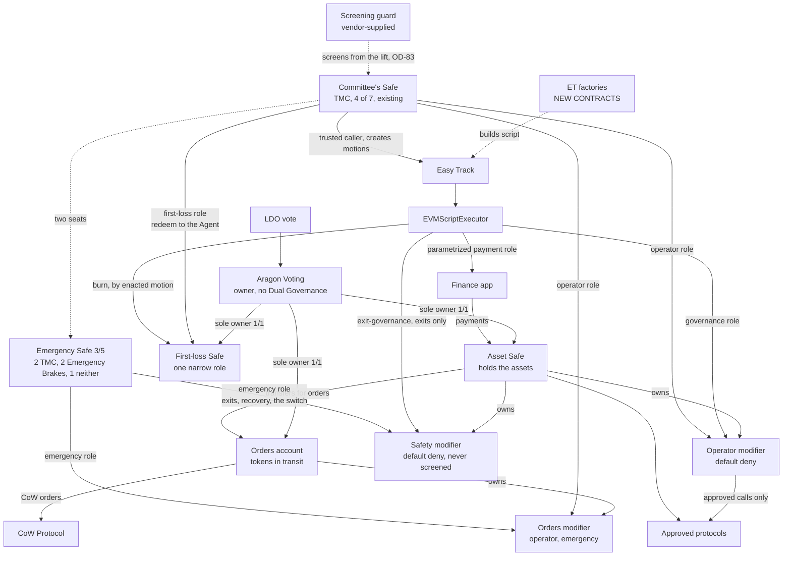

# LIP-XX: Active Treasury Management Vault

| LIP field | Value |
|---|---|
| lip | to be assigned |
| title | Active Treasury Management Vault |
| status | WIP |
| author | to be filled by proposers |
| discussions-to | a thread on https://research.lido.fi/, to be created |
| created | 2026-09-22 |

> **Draft.** Written during the design review of 2026-09-10 to 2026-09-22; imported on 2026-09-30. The [ADRs](/adr/index.md) govern this draft [s2]. Chain facts used by the ADRs were re-read at block 26092572 [s3]. Other chain claims come from the design review and were not re-run. Section 9.1 records the screening decisions (OD-54, OD-83), and section 5.2 the funding decisions (OD-06, OD-89). See [open decisions](/registers/open-decisions.md).

> **Status labels.** **[Implemented]** means built and tested against deployed bytecode on a pinned mainnet fork. **[Specified]** means designed but unbuilt. **[Open]** means a decision is required. Nothing is deployed to mainnet. No audit has been performed.

## Simple Summary

The Treasury Management Committee can use a bounded part of the DAO treasury in approved DeFi protocols. The DAO keeps ownership; neither the committee nor a service provider can take the assets.
On-chain permissions limit the committee's actions. An emergency Safe can return assets and disable the operator; only the DAO can restart it.
Easy Track motions onboard and remove strategies through templates fixed at audit time. The emergency Safe can revoke permissions immediately (OD-70).

## Abstract

Aragon Voting is the sole owner of the Asset Safe (OD-73).
On the Asset Safe, two Zodiac Roles modifiers enforce default-deny permissions:

- The operator modifier carries `operator`, held by the committee's Safe, and `governance`, held by the Easy Track executor.
- The safety modifier carries `emergency`, held by a new three-of-five Safe: two committee members, two Emergency Brakes members and one member of neither body.

The committee cannot form the emergency quorum alone. The Emergency Brakes multisig retains only the global Easy Track pause and touches no funds.
No emergency body can restart what it stopped.

All swaps use CoW orders from a dedicated account owned by Aragon Voting.
Each role's permissions pin the receiver: the Asset Safe for operator orders, the Agent for recovery orders.
Prices have no on-chain bound. CoW's competition rules, screening, budgets and fill monitoring provide the controls.

Easy Track motions onboard protocols and assets and adjust budgets within ceilings.
Factories build complete permission trees from templates fixed at audit time; motions supply parameters only.
Routine removal uses a removal-template motion. Emergency removal uses immediate revocation.

Easy Track EVM script factories are the only new contracts. CoW's order signer has no known audit, so it counts as new code with them (OD-96).
No bespoke access-control, vault or accounting contract is introduced.
Funding reuses the existing Finance application and allowed-recipients machinery already in production.

## Motivation

### Background

The DAO treasury holds idle assets. A [Treasury Management Committee](https://docs.lido.fi/multisigs/committees#25-treasury-management-committee) exists and, by the principles under which it was formed, never takes custody. Putting treasury assets to work therefore requires a system where the committee can transact but cannot possess, and where the DAO can reverse any of it.

### Problem

Three properties are needed at once and no existing Lido component provides them together.

1. **Custody must stay with the DAO.** The DAO must remain the only owner of the vault, through Aragon Voting (OD-73), and recovered assets go to the Aragon Agent, the DAO's treasury. No provider outage, suspension, or contract termination may change that.
2. **Authority must be bounded before execution, not after.** A report-and-remediate control does not stop a transaction. The system must deny unapproved targets, functions, and parameters at execution time.
3. **Routine changes must not require a full DAO vote, and must still not be arbitrary.** Adding an approved strategy should be an Easy Track motion with an objection window. That motion must not be able to widen authority beyond what the DAO already approved.

A conventional multisig fails the second property. A provider-operated vault fails the first. Granting Easy Track general execution authority over the Agent fails the third, because it would let a motion forward any script as the Agent and would put the entire treasury behind a three-day objection window.

### Solution

Separate **custody**, **authority**, and **change control** into three layers that are already audited, and add only the thin glue that Easy Track's interface requires.

- Custody: a Safe owned one-of-one by Aragon Voting (OD-73).
- Authority: two Zodiac Roles modifiers enabled as modules on that Safe, with the Safe as their owner.
- Change control: Easy Track motions through purpose-built script factories, which build every permission from a template fixed at audit time.

## Specification

### Overview



Each role executes **as the Safe** through `execTransactionFromModule`, after the modifier checks its permissions.

### Rationale

**Modifier ownership.** A role executes with the Safe avatar's authority.
The Safe owns its modifiers, so scoped roles can administer them without a DAO vote: emergency revokes the operator in minutes, and governance changes policy by motion.

**No Easy Track authority over the Agent.** At block 26092572, only the Dual Governance admin executor holds the Agent's `RUN_SCRIPT_ROLE` and `EXECUTE_ROLE` [s3].
Giving either to Easy Track would let motions forward arbitrary Agent scripts.
The governance role supplies only the required modifier authority.

**Fixed templates.** A permission write replaces the entire role/target/selector slot.
Accepting motion-authored trees would require on-chain checks that each replacement is strictly narrower than what it replaces. That requires a tree comparison during the objection window.
Instead, factories accept typed parameters, such as target, asset and budget key, and build complete trees from fixed templates.
The audit covers that finite set of templates.
A motion cannot express permissions outside its template.

**Emergency quorum.** The emergency role is easier to reach than the operator role. A lower quorum shortens response time for its one-way revocation, exits and returns to the Agent without widening those powers.
These powers only reduce exposure, but recovery orders can lose value: they have no on-chain price floor.
Only CoW's rules hold their fill to the on-chain market (OD-43, OD-48).

**Separate orders account.** Direct pre-signing exposes only a hash, which hides tokens, amounts and receiver from the permission layer.
CoW's order signer accepts typed orders and computes that hash, so permissions can pin tokens, receiver and life.
TWAP requires CoW's fallback handler, which the Asset Safe does not have.
The Voting-owned orders account carries the handler and holds only tokens in transit.

The caller chooses the order limit, so price controls depend on screening, budgets and fill monitoring.
The committee needs limit and TWAP orders, which the previous treasury swap contracts did not support (OD-43).
The launch excludes stop-loss orders (OD-79).

**Budgeted approvals.** A spender can pull funds without a deposit call, and an operator can restore an approval.
Each approval to a protocol spender spends that spender's budget key, which bounds total approvals per key per period regardless of spender behaviour (OD-08).

### Technical Specification

---

#### Part 1: Account graph **[Implemented in part]**

| Component | Address | Source |
| --- | --- | --- |
| Aragon Agent | `0x3e40D73EB977Dc6a537aF587D48316feE66E9C8c` | existing |
| Aragon ACL | `0x9895F0F17cc1d1891b6f18ee0b483B6f221b37Bb` | existing, resolved via `Agent.kernel().acl()` |
| Dual Governance admin executor | `0x23E0B465633FF5178808F4A75186E2F2F9537021` | existing |
| Finance application | `0xB9E5CBB9CA5b0d659238807E84D0176930753d86` | existing, `vault()` returns the Agent |
| Easy Track | `0xF0211b7660680B49De1A7E9f25C65660F0a13Fea` | existing |
| EVMScriptExecutor | `0xFE5986E06210aC1eCC1aDCafc0cc7f8D63B3F977` | existing |
| **TMC multisig, the committee's Safe** | `0xa02FC823cCE0D016bD7e17ac684c9abAb2d6D647` | existing, Safe v1.3.0, threshold 4 of 7. Holds the operator role and the **first-loss** role (OD-60, OD-80), and is the trusted caller of every factory, the first-loss burn factory included (OD-67). Two of its signers sit on the Emergency Safe. It carries the screening guard from the lift of the launch cap (OD-83) |
| Emergency Brakes multisig | `0x73b047fe6337183A454c5217241D780a932777bD` | existing, threshold 3 of 5; holds the global Easy Track pause and no role in the vault; two of its members sit on the Emergency Safe (OD-58) |
| **Emergency Safe** | to be deployed | new Safe v1.5.0 instance, **threshold 3 of 5**: two TMC members, two Emergency Brakes members and a fifth signer who is a member of neither body. No guard |
| Safe singleton v1.5.0 | `0xFf51A5898e281Db6DfC7855790607438dF2ca44b` | reused. `VERSION()` returns `1.5.0`, and the runtime codehash equals `0xdda019cbd7c867a533a2a86e5c53434fdc50b13122b5a5ddb4a8df61b31c20f2`, matching the published deployment record. Released 2025-07-03, audited by Certora and Ackee at pinned commits, covered by the Safe bug-bounty programme. The Asset Safe and the Emergency Safe use v1.5.0, by EM's decisions of 2026-10-02 and 2026-10-05 [s1]; the committee's existing Safe runs v1.3.0 (OD-80). The screening vendor's guard passed the same fork suite on v1.3.0, v1.4.1 and v1.5.0 [s6]. None of the six Lido Safes checked runs v1.5.0 today. Its record of holding value is short; see Security Considerations [s8] |
| Safe proxy factory v1.5.0 | `0x14F2982D601c9458F93bd70B218933A6f8165e7b` | reused |
| Zodiac Roles mastercopy | `0xF2964CE6161ce0e75964Fe7927cE114cb0B283D5` | reused, `owner()` is `0x…01`, i.e. locked |
| Zodiac ModuleProxyFactory | `0x000000000000aDdB49795b0f9bA5BC298cDda236` | reused |
| **Asset Safe** | to be deployed | new instance of the singleton. No guard and no fallback handler are set on it. Aragon Voting, its only owner, authorizes its transactions only by `approveHash` or by sending them itself, never by a contract signature (OD-17, OD-73) |
| **Operator modifier** | to be deployed | minimal proxy of the mastercopy. Carries the operator and governance roles. The operator role is held by the committee's Safe (OD-80) |
| **Safety modifier** | to be deployed | minimal proxy of the mastercopy. Carries the emergency role, and the exit-governance role through which a motion adds an emergency exit (OD-49). Never screened |
| **Screening guard** | vendor-supplied | the screening vendor's existing transaction guard, one instance, set with `setGuard` on the committee's Safe when the launch cap lifts (OD-83). Not written by Lido |
| **Orders account** | to be deployed | new Safe instance owned by Aragon Voting, one of one, with CoW's `ExtensibleFallbackHandler` at `0x2f55e8b20D0B9FEFA187AA7d00B6Cbe563605bF5` and ComposableCoW as the verifier of CoW's settlement domain. Holds only tokens in transit between a transfer and a fill. It has one modifier with the operator and emergency roles, and no governance role: a DAO vote adds a token (OD-43, OD-57, OD-58, OD-78) [s11] |
| **First-loss Safe** | to be deployed | new Safe instance owned by Aragon Voting, one of one, with no guard or fallback handler. Holds only the DAO's first-loss Earn shares. One modifier carries two roles: **first-loss**, held by the committee's Safe, redeems the shares with the proceeds pinned to the Agent (OD-42, OD-60); **first-loss-burn**, held by the EVMScriptExecutor, burns them only as an enacted motion (OD-67) |
| CoW order signer | `0x23dA9AdE38E4477b23770DeD512fD37b12381FAB` | reused, verified `CowswapOrderSigner`; called by delegatecall from the orders account [s11]. It has no known audit, so it counts as new code with the factories (OD-96) |
| ComposableCoW and its TWAP handler | `0xfdaFc9d1902f4e0b84f65F49f244b32b31013b74`, `0x6cF1e9cA41f7611dEf408122793c358a3d11E5a5` | reused; Ackee audited ComposableCoW and CoW's fallback handler, and Gnosis reviewed ComposableCoW; whether the TWAP handler is in those reports' scope is not checked [s11] |

The Emergency Safe, the orders account and the first-loss Safe are new instances of the audited Safe singleton, not new contract code. Aragon Voting owns the orders account and the first-loss Safe (OD-73). The committee's Safe is the TMC multisig itself, so no owner set needs to follow it (OD-80). The Emergency Safe's two TMC seats and two Emergency Brakes seats follow their bodies: a signer who leaves a body leaves the seat. That reconciliation is an operational duty with no on-chain enforcement, and an owner change on the Emergency Safe is a critical alert.

**Deployment constraints.**

1. The Roles mastercopy keeps its own storage from slot 0. Deploying it behind a Safe proxy overwrites the proxy's implementation pointer with the avatar address and bricks the instance. It **must** be deployed through the Zodiac `ModuleProxyFactory`, which produces EIP-1167 minimal proxies that hold the implementation in bytecode.
2. The deployed mastercopy predates the current upstream source. Its initialiser is `setUp(bytes)` taking `abi.encode(owner, avatar, target)`, not the three-argument form. Audits and deployment tooling must pin the deployed bytecode, not repository HEAD.
3. Each modifier's `owner`, `avatar` and `target` are its own Safe.
4. The Asset Safe is set up with no fallback handler. Without one, it refuses ERC-721 and ERC-1155 safe transfers and cannot sign a message by EIP-1271. A protocol that needs either comes back to EM (OD-17).
5. The orders account is set up with CoW's fallback handler, and its domain verifier for CoW's settlement domain is ComposableCoW. A fork rehearsal set both on a Safe v1.5.0 but placed no order [s14]. Fork tests of signed and TWAP orders must pass before the account is relied on [s11].

#### Part 2: Roles and authority **[Implemented in part]**

The principals and their roles follow. Role keys are `bytes32`; the encoding must match the tooling that applies the policy and is a deployment-time check.

| Role | Holder | May do | May not do |
| --- | --- | --- | --- |
| DAO | Aragon Voting, by vote, as the only owner (OD-73) | Everything: owns the Safe, may replace the whole policy, may add or remove role members | — |
| `operator` | Committee's Safe, the TMC signers, screened | Open, adjust, and close positions in approved protocols within budgets; approve approved spenders, each approval spending its spender's budget key or staying below a fixed ceiling (OD-08); stake ETH; convert DAI to USDS and back through Sky's converter, pinned to the Asset Safe; fund the orders account under budgets and place CoW orders there that pay the Asset Safe (OD-43) | Transfer any asset out, except into the orders account; borrow; create debt; administer a modifier or a Safe; change its own permissions |
| `emergency` | Emergency Safe, three of five: two TMC members, two Emergency Brakes members and one member of neither body. **Safety modifier** and the orders modifier | Set approvals to zero; exit positions to the Safe; unwrap wstETH and WETH, stake ETH and redeem sUSDS; transfer assets to the Agent or to the orders account; on the orders account, cancel orders, send tokens to the Agent or the Asset Safe, and place recovery orders that buy USDC or USDT and pay the Agent; revoke the operator's targets and functions, for an emergency removal (OD-70); disable the **operator** modifier, with the module argument pinned, for a defect in the permission layer or on the cap-breach trigger (OD-29, OD-58) | Add any permission; enter any protocol except by staking ETH; borrow; reach the first-loss Safe; change the recovery destination; disable the safety modifier or the orders modifier; restore what it stopped (OD-59) |
| `governance` | EVMScriptExecutor, driven by Easy Track | Write operator permissions from a fixed template, for a target named in a motion; set operator budgets within ceilings | Submit a condition tree; grant or remove any role; touch the emergency role; target the modifier's avatar or any of its modules; grant delegatecall |
| exit governance | EVMScriptExecutor, driven by Easy Track. **Safety modifier** | Write the emergency role's exit for a target that an onboarding motion names, from the same template: redeem, withdraw, claim and cancel pinned to the avatar, a transfer pinned to the Agent, an approval set to zero (OD-49) | Write anything but an exit; grant delegatecall; touch membership or the switch; set an allowance; target the Asset Safe or any of its modules |
| `first-loss` | Committee's Safe, the TMC signers, four of seven, screened once the launch cap lifts. **First-loss modifier** | Request and claim the redemption of the DAO's earnETH and earnUSD shares, with the proceeds pinned to the Agent; on the Earn team's written instruction under the March 2026 terms (OD-60) | Burn, transfer or approve the shares; pay anyone but the Agent |
| `first-loss-burn` | EVMScriptExecutor, driven by Easy Track. **First-loss modifier** | Burn the DAO's earnETH and earnUSD shares, as an enacted motion that the committee's Safe created on the first-loss burn factory (OD-67) | Anything else |

**Two classes of risk, and who answers each.**

*Financial risk* is the common case: a depeg, a dependency failure, a curator acting against the vault's interest, a position that must be unwound now. These need someone who watches the portfolio daily, understands the positions, and can act in minutes. The operator, the committee at four of seven, handles routine defence: exits and sales into the Asset Safe. The emergency role covers the stop, the way home and recovery orders: revoke, switch off, exit, swap to stablecoins, return to the Agent. Its Safe seats two committee members beside two Emergency Brakes members and one member of neither body, so neither body acts alone.

*Technical risk* is rarer and different in kind: a defect in the permission layer itself, or a report arriving through the bug-bounty programme. Two mechanisms cover it. The global Easy Track pause, held by the Emergency Brakes multisig, stops any pending governance change from enacting. Module disabling, held by the emergency role, switches the operator modifier off, and with it every queued vault motion that writes through that modifier. The safety modifier keeps working, so recovery survives.

The switch sits with the emergency Safe, whose two Emergency Brakes members bring the engineering view and the bug-bounty channel. The Emergency Brakes multisig keeps only the global Easy Track pause, as its 2022 mandate says, and touches no funds (OD-58). No emergency body restarts what it stopped: a DAO vote unpauses Easy Track or enables the operator modifier again, as a direct Voting item (OD-59, OD-73).

The two stops answer different failures. Pausing Easy Track stops every pending motion of the DAO, top-ups included. It does not stop an operator transaction, and it does not stop a defect in the permission layer from being exercised. Only module disabling does that.

**Composition note.** Every quorum of the emergency Safe needs a signer from outside the committee and a signer from outside the Emergency Brakes multisig. The committee cannot act alone in an emergency, and two stolen committee keys reach nothing. The only quorum without a committee member is the two Emergency Brakes members and the fifth signer. That quorum is the mandate's emergency committee, independent of the committee, and it has no spare signer (OD-58). The cost is speed: every emergency action needs a signer from outside the committee, and no response-time data exists for such a group, so a timed drill runs before launch.

#### Part 3: Permission encoding **[Implemented]**

Permissions are condition trees stored per `(roleKey, target, selector)`. Enum values below are from the deployed mastercopy and are normative for tooling.

`ParameterType`: `None=0`, `Static=1`, `Dynamic=2`, `Tuple=3`, `Array=4`, `Calldata=5`, `AbiEncoded=6`.

`Operator`: `Pass=0`, `And=1`, `Or=2`, `Nor=3`, `Matches=5`, `ArraySome=6`, `ArrayEvery=7`, `ArraySubset=8`, `EqualToAvatar=15`, `EqualTo=16`, `GreaterThan=17`, `LessThan=18`, `Bitmask=21`, `Custom=22`, `WithinAllowance=28`, `EtherWithinAllowance=29`, `CallWithinAllowance=30`.

Rules that constrain how policy must be written:

- **A write replaces a slot.** A second `scopeFunction` on the same role, target, and selector discards the previous tree. Policy must therefore be emitted as complete trees, and any tooling that appends permissions per-token must merge them before writing.
- **`Matches` requires exactly as many children as the call has parameters** at the level being matched. Trailing parameters that need no constraint take `Pass`.
- **Alternative calldata shapes use `Or` at the root** over full `Matches` branches. This is how per-spender budgets are expressed on `approve`: one branch per spender, each with its own `EqualTo` on the spender and its own `WithinAllowance` on the amount, or a `LessThan` ceiling for a spender with no key. Budget keys are independent across branches.
- **A budget key counts token units**, so a key shared across assets of different decimals is a defect. Each decimal class needs its own key.
- **Array elements are constrained with `ArrayEvery`** over a single child condition.
- **`Custom=22` invokes an external adapter by `staticcall`.** The adapter address is the leading 20 bytes of the 32-byte comparison value; 12 bytes of caller-defined data follow. Because it is a static call the adapter can read state but cannot write, cannot maintain a ledger, and cannot consume an allowance. No adapter is used in this proposal.

#### Part 4: Governance — the new contracts **[Implemented in part]**

Easy Track EVM script factories are the only new contracts. They hold no assets or independent authority.
They build scripts; the modifier checks the resulting calls.

Every factory emits the production script format, `[specId(4)][to(20)][calldataLength(uint32)][calldata]`, where the length covers the selector and the arguments. This matches `EVMScriptCreator` in the Easy Track source. A 32-byte length field is **not** the production format and must be rejected.

##### 4.1 Defence in depth in the modifier **[Implemented]**

The governance role is separately constrained so that a factory bug cannot reach administration.

- Every administrative selector granted to the governance role pins the role key to `operator` by `EqualTo`, and refuses the Asset Safe and every module of the Asset Safe as the administered target using `Nor(EqualTo(safe), EqualTo(operator modifier), EqualTo(safety modifier))`. The deployment manifest lists the modules, and the compiler refuses a policy without this guard (OD-38). [s1]
- `setAllowance` takes only an operator budget key, and a period of at least 30 days (OD-08).
- `allowFunction` and `scopeFunction` take only the execution options None or Send. A motion cannot grant delegatecall (OD-36).
- `assignRoles` and `setDefaultRole` are **not** granted (OD-09). Membership changes are a DAO vote.
- The exit-governance role on the safety modifier carries the same guards, with the role key pinned to `emergency`, and no `setAllowance` at all (OD-49).

Pinning the role key alone does not stop escalation: a grant targeting a modifier lets the operator reach owner-only administration through the avatar.
A factory bug can still grant calls on ordinary targets; templates and the objection window control that risk.

##### 4.2 Template factories for onboarding **[Specified]**

Not yet built. Each factory builds a permission tree from one template and typed motion parameters.
This lets Easy Track onboard protocols or assets without a DAO vote.

EM accepted the catalogue on 2026-09-22 [s1]. Since then the swap-instance template has left (OD-46), and one removal template has come back for routine removals (OD-70). A token for the orders account needs a DAO vote, because no motion writes there (OD-36, OD-46, OD-78). Before the vote, the catalogue check keeps only the onboarding templates that a protocol in the committee's named pipeline needs (OD-72, OD-79).

| Factory | Motion parameters | Emits |
| --- | --- | --- |
| `AddWrapFactory` | wrapper, underlying | `wrap` and `unwrap`, or `deposit` and `withdraw` on WETH; the output returns to the avatar |
| `AddERC4626VaultFactory` | vault, asset, budget key | the asset's `approve` to the vault, spending the budget key; `deposit` with receiver `EqualToAvatar`; `redeem` and `withdraw` with receiver and owner `EqualToAvatar` |
| `AddQueueVaultFactory` | vault, asset, budget key | the asset's `approve` to the queue, spending the budget key; the asynchronous deposit request with any owner pinned to the avatar; the redeem request, cancel and claim with receiver and owner pinned to the avatar |
| `AddSpenderApprovalFactory` | token, spender, budget key | a branch of the token's `approve` scope with that spender pinned and the amount spending the budget key; zero spends nothing |
| `AddMorphoBlueMarketFactory` | Morpho-Blue-compatible contract, market parameters, budget key | the loan token's `approve` to that contract, spending the budget key; `supply` with `onBehalf` pinned to the avatar; `withdraw` with `onBehalf` and `receiver` pinned to the avatar. Lido Lend is its own deployment, so its address arrives with the motion (OD-49). **Ships at launch even though no market address exists yet.** Acceptance requires end-to-end tests against the deployed Morpho Blue contract on a fork, so the template is proven before the market it will be pointed at exists |
| Removal template | target, function, and the branch to remove | the function's complete tree without that branch; never a new branch, target or function (OD-70) |
| Claim template | protocol, reward contract | the protocol's reward claim with the receiver pinned to the avatar; ships only if a launch protocol pays rewards (OD-72) |

A lending-pool template for markets such as Aave is not in the catalogue, because third-party lending markets are outside the launch scope.

**Each template also writes the emergency exit (OD-49).** The same script uses exit-governance on the safety modifier to grant the emergency role its target's exits:

- Redeem, withdraw, claim and cancel, with receiver and owner pinned to the avatar.
- Transfer of the new receipt token to the Agent.
- Zero approval of the new spender.

It grants no entry, deposit or non-zero approval. The exit exists at enactment and survives the emergency role's switch.

The trusted caller of every factory is the committee's Safe (OD-80), as it already is for the treasury swap factories. Every template factory hard-codes the role key to `operator` and refuses the Asset Safe, the orders account and their modules as a target.

**Onboarding disclosure.** Before the motion, publish the target, template, initial budget and diligence on the forum.
Configure monitoring and alerts before enactment, and update the incident runbook.
The objection threshold stops the motion. If that fails, the Emergency Brakes multisig can use the global Easy Track pause.

**Routine removal (OD-70).** As decided on 2026-10-14, a removal-template motion writes the complete tree without the removed branch.
It preserves other branches and waits for the objection window.
Emergency removal uses immediate `revokeTarget` or `revokeFunction`, pinned to `operator`, followed by a forum post (OD-09).

Invariants an audit must confirm for each template: no receiver, owner, or beneficiary field is ever left open; every value-moving amount is either budgeted or capped; no template can emit an administrative selector; and the emitted script parses under the production script format.

The mandate must state that a motion can select an unaudited contract.
Pinned receivers and budgeted amounts limit loss to the attached budget.
The objection window, published diligence and monitoring provide the controls.

##### 4.3 `BudgetEVMScriptFactory` **[Specified]**

Not yet built. Adjusts an operator budget. The modifier constrains `setAllowance` natively. The kit's policy already has the key list and the period floor. The per-key ceilings wait for the attested figures; a kit test shows the shape [s4].

- the allowance key must be one of the operator's budget keys, the spare keys of each token included (OD-69), by `Or` of `EqualTo`;
- `balance`, `maxRefill`, and `refill` are each bounded by `LessThan` the ceiling of their key, in one branch per key;
- `period` is bounded below by `GreaterThan` 30 days minus one second, so the shortest period is 30 days (OD-08). This prevents a motion from turning a monthly budget into a per-second one.
- one motion can set several keys, each within its own ceiling (OD-94).

##### 4.4 First-loss burn factory **[Specified]**

Not yet built. EM decided on 2026-10-13 that no first-loss burn runs without the objection window (OD-67). Every burn of the DAO's first-loss Earn shares is therefore a motion of this factory.

- The motion carries an amount and a share token. The factory pins the two share tokens, earnETH and earnUSD, and refuses any other.
- The script calls `execTransactionWithRole` on the first-loss modifier with the role key `first-loss-burn`, and the call `burn` on the share token, so the first-loss Safe burns its own shares.
- The `first-loss-burn` role allows only `burn` on the two share tokens, with no value and no delegatecall. The EVMScriptExecutor holds it.
- The trusted caller is the committee's Safe. The forum post with the Earn team's written instruction and the curators' confirmation goes up with the motion.
- It writes no permission. It is the only motion in this proposal that moves value away from the DAO: a burn passes the shares' value to the vault's other depositors, as the March 2026 terms intend.

#### Part 5: Funding **[Specified]**

Funding reuses production machinery. No new contract class beyond a factory.

The Easy Track script executor already holds `CREATE_PAYMENTS_ROLE` on the Finance application with 22 Aragon ACL parameters attached. Those parameters form a conditional chain binding argument 0 (token) and argument 2 (amount). Argument 1 is the **receiver and is not constrained at the ACL layer**; recipient control lives one layer above, in the registry and factory.

Per-payment ceilings recorded in the ACL parameter tree, re-read at block 26092572 [s3] and unchanged at block 26125804 [s7]. The enabling vote adds USDS with a ceiling of 2,000,000 per payment (OD-11, OD-24):

| Token | Ceiling per payment |
| --- | --- |
| stETH | 1,000 |
| ETH | 1,000 |
| DAI | 2,000,000 |
| USDC | 2,000,000 |
| USDT | 2,000,000 |
| sUSDS | 2,000,000 |
| USDS | 2,000,000, once the enabling vote adds it |
| LDO | 5,000,000 |

Many allowed-recipient setups already run on mainnet, each combining an `AllowedRecipientsRegistry` with period limits, optionally an `AllowedTokensRegistry`, add and remove factories, and a `TopUpAllowedRecipients` factory. Twelve top-up registries are live, and the committee's existing Safe is the trusted caller of two of them [s7].

**Setup, decided by EM on 2026-10-02 (OD-06):** two dedicated registries, one for stablecoins and one for stETH. The Asset Safe is the only recipient of each, and the Easy Track executor cannot add recipients. Each registry has a period of one calendar month and a limit of one mandate size per period, as a backstop (OD-89). Two `TopUpAllowedRecipients` factories, the stablecoin one with the shared stablecoin token list, to which the vote adds USDS (OD-11), take the committee's Safe as trusted caller and are registered by DAO vote [s7]. The registry factories deploy both registries with Aragon Voting as admin; the deployer sets them up and gives up its roles, and a check before the vote proves every role (OD-92). Section 5.2 gives the reasons and the gaps.

##### 5.1 Scaling the existing caps to the mandate size **[Investigated]**

Findings, first read at block 26017715 and re-read at block 26092572 [s3].

- **The ACL ceilings are per call, not per motion or per period.** Each `newImmediatePayment` is authorised separately. A single motion whose script contains several payment calls is therefore bounded by the number of calls, not by the ceiling.
- **The Finance application adds no second cap.** Token budgets are disabled: `getBudget` returns amount 0 with the budgeted flag false for USDC, DAI, and stETH. The 30-day period exists but binds nothing.
- **The grant is shared.** The parametrized `CREATE_PAYMENTS_ROLE` is held by the single Easy Track script executor, which every Lido top-up factory routes through. Raising a ceiling raises it for every allowed-recipient setup at once.
- **The permission manager is Aragon Voting** at `0x2e59A20f205bB85a89C53f1936454680651E618e`, so any parameter change is an Aragon vote, and the whole 22-entry parameter array is rewritten as one unit.

**Decision: add USDS to the shared parameters (OD-11).** EM decided on 2026-10-05 that a DAO vote rewrites the array to add USDS, and that the stablecoin registry uses the shared token list with USDS added. Seed and top up through several payments inside one motion, and let the real ceiling be the period limits on the two dedicated registries (section 5.2). The number of payments follows from the limits and the ceilings, and an attested computation must produce it. The rewrite is DAO-wide: every setup that shares the token list can then pay USDS too, and the vote must say so.

Two consequences to accept. A per-payment ceiling is not a per-motion ceiling, so the registry period limit is the backstop that matters, and section 5.2 sizes it. And **funding in sUSDS goes beyond the mandate's funding rule**, which names stETH and the top-four stablecoins: the mandate text must add it, and an sUSDS top-up counts at once against its yield-bearing cap. The funding assets are USDC, USDT, DAI, USDS, sUSDS and stETH. ETH is not one: the Agent holds less than 8 ETH (OD-11) [s7].

##### 5.2 Period and limit **[Decided, OD-06 and OD-89]**

The mandate puts seeding and top-ups on Easy Track, and it makes the objection the control of a top-up. The registry is the backstop.

**The mandate size (OD-89).** The vault holds up to the mandate size in assets. Each funding counts in US dollars at its value when it is funded, and the legacy positions count too. More funding needs a separate DAO approval, and a replenishment needs the mandate's published eligibility conditions and its disclosure. The vault never holds more than the mandate's share of the DAO's non-LDO treasury. The size is a ceiling: no top-up refills the vault to it by right.

**The legacy Earn shares (OD-21).** The DAO's first-loss shares in earnETH and earnUSD, approved by Snapshot in March 2026, sit in a Growth Committee Safe [s10]. After the enabling vote, the Growth Committee transfers them to the first-loss Safe. The seed is at most the mandate size less their value at the report's price rule, and at most the launch cap until the lift (OD-42, OD-54, OD-89, OD-98). This proposal takes over the first-loss terms of that allocation, with the committee as executor in place of the Growth Committee (OD-60); Parts 1 and 2 and section 4.4 give the roles. Reports show the first-loss Safe as a sub-allocation of the vault. A Twyne position counts against the seed only when its holder and form are shown.

- **Period: one calendar month.** EM chose it on 2026-10-02 for a monthly refill to a floor, which the mandate no longer has (OD-89). It stays as the backstop's period until the mandate publishes the eligibility conditions of a replenishment. No live Lido registry uses one month; they use three, six or twelve [s7].
- **Limit: one mandate size per registry per month.** Stablecoins count at par. The stETH limit is the mandate size at the Coingecko price pinned when the enabling vote is prepared, set by attested computation. Either asset can carry the seed.
- **Why two registries.** A registry counts token units after scaling decimals, so 1 stETH counts as 1 USDC. One limit cannot hold both assets to a dollar figure [s7].
- **Gap 1: more than the mandate size.** Without an objection, the committee's Safe can pull one mandate size per registry each month. Around a month boundary, one registry can pay two full limits within about 72 hours, because a motion that can only be enacted in the next period is checked against that period's full limit [s7]. The mandate size and the treasury share are therefore a procedure, not code.
- **Gap 2: the stETH limit is fixed in tokens.** The mandate counts each funding at its value when it is funded. After an ETH fall, the stETH limit is worth less than the mandate size; after an ETH rise, it is worth more. Neither moves the size, which monitoring counts in dollars at funding. The DAO re-pins the limit by vote when needed.
- **Compensating controls.** The committee's Safe creates every top-up motion, so each one waits for the 72-hour objection window and, from the lift, passes the screening guard (OD-83). Each top-up's forum post states the funded value, the headroom under the mandate size, and the vault's share of the DAO's non-LDO treasury. Monitoring flags a top-up above that headroom; a top-up motion that would take the vault above the size or the share; and any top-up motion after an objected one. The screening policy carries a dollar rule per motion, if the vendor supports it (OD-07).
- **What the registry cannot enforce.** The mandate's rule that, after an objection, a further pull needs a Snapshot vote. A DAO vote can set the limit to zero. Nothing enforces the treasury share when the treasury's own spending or a price move breaches it; the mandate owes the remedy.

#### Part 6: Emergency response **[Implemented in part]**

On the Asset Safe, the emergency role's permissions are in the **safety modifier**; on the orders account, they are in the orders modifier. The emergency Safe never passes through the screening guard.

The emergency role holds, and nothing else:

- `approve(spender, 0)` on each token that the operator can approve, spender drawn from the operator's spenders;
- exits: savings-vault redeem and withdraw with receiver and owner pinned to the avatar; asynchronous vault cancel, claim, and redeem. The first-loss shares sit in the first-loss Safe, which the emergency role does not reach (OD-42, OD-60);
- conversions: `unwrap` on wstETH and on WETH, and `submit` on stETH with the referral pinned to zero (OD-20);
- `transfer(to, amount)` with `to` pinned by `EqualTo` to the Agent literal, on every asset and receipt token the Safe can hold;
- `revokeTarget(operator, …)` and `revokeFunction(operator, …)` on the operator modifier, and on the orders modifier once it exists, role key pinned to the operator;
- `disableModule(prevModule, operatorModifier)` on the Asset Safe, the switch, with the module argument pinned (see 6.2);
- `transfer(to, amount)` with `to` pinned by `EqualTo` to the orders account, and on the orders account: cancel any order, revoke the operator's targets and functions, set a relayer approval to zero, send any listed token to the Agent or the Asset Safe, and place recovery orders that buy USDC or USDT and pay the Agent (see 6.1). These are specified, not built: the orders account does not exist yet.
- the exits that an onboarding motion adds through the exit-governance role: redeem, withdraw, claim and cancel pinned to the avatar, a transfer pinned to the Agent, and an approval set to zero (OD-49). Specified, not built.

Nothing in this role restores authority: no `enableModule`, no grant, no budget and no non-zero approval. The compiler refuses a policy that gives it one (OD-59).

Separately and already deployed: the Emergency Brakes multisig holds the pause role on Easy Track and holds neither unpause nor cancel. Pausing Easy Track freezes every queued motion of the DAO, and only the DAO can resume. The switch freezes the vault's own queued motions without that pause. A motion does not expire, so before the DAO restarts either, the same vote cancels the queued motions that must not enact.

##### 6.1 Swapping — CoW orders from the orders account **[Specified]**

Neither role receives an exchange permission on the Asset Safe. Every swap, routine or emergency, is a CoW order placed from the orders account: a Safe owned by Aragon Voting, with CoW's fallback handler and one modifier of its own (OD-43, OD-57) [s1][s11].

The path:

1. The role transfers the asset from the Asset Safe to the orders account, with the recipient pinned by `EqualTo`. For the operator, the transfer spends that token's orders budget.
2. On the orders account, the role places an order. A market or limit order goes through a delegatecall to the deployed CoW order signer, which computes the order identifier from the typed order and sets the pre-signature. The permission pins the sell and buy tokens, the receiver, the order's maximum life and the fee bound. A TWAP order goes through ComposableCoW, with the handler, the receiver and the tokens pinned. The launch has no stop-loss orders (OD-79).
3. CoW settles the order and pays the receiver directly.

**The receiver is what separates the two roles.** It is pinned in each role's permissions:

| Role | Orders | Receiver | Effect |
| --- | --- | --- | --- |
| `operator` | Market, limit and TWAP, between the operator's listed tokens | Asset Safe | The operator can trade but cannot move value out |
| `emergency` | Market and limit orders that buy USDC, or USDT as the second destination, and live at most 1 day | Aragon Agent | Proceeds go to the DAO treasury, the mandate's fixed recovery destination |

**Custody in the account.** The orders account carries the fallback handler that the Asset Safe lacks (OD-17), and holds only tokens in transit. The budgets bound the operator's transfers into it; the emergency role's transfers have no budget. The enabling vote has the account approve CoW's vault relayer for the maximum amount of every token on the lists, and no role can raise an approval there, so a recovery order settles even when the operator is revoked. If the emergency role sets an approval to zero, every order in that token stops, recovery orders included, until a DAO vote sets it again; sending the token to the Agent stays open. A change of its fallback handler or domain verifier is a critical alert.

**Price protection.** Nothing on chain bounds the price of the vault's orders: the order signer and TWAP orders leave the amounts to the caller, and the modifier can compare a parameter only with fixed values. ComposableCoW's GoodAfterTime order type can check a price checker's expected output, but it needs an order poster of Lido's own and a checker that ignores stale feeds, so the design does not use it (OD-48) [s11]. CoW's rules hold every fill to at least the on-chain market: bonded solvers compete on the surplus for users, and a solver that fills worse than on-chain AMM routing must refund the user or loses its bond [s11]. The bound is the order's own terms, with CoW's solvers competing to fill above the limit; from the lift, the screening of every operator transaction, with a price check requested from the vendor; the budgets on the operator's transfers into the account; and monitoring of each fill against a market price [s12]. The emergency role's orders are not screened, so for them only paging and monitoring remain.

**Routers.** None at launch. A router swap pins its recipient but not its price, because its minimum output is an absolute number. Uniswap and 1inch wait until the screening vendor can bound a swap's minimum output before execution (OD-43).

What it costs, and what must be planned:

- **Conditional orders need a watch-tower.** CoW's watch-tower posts them to the order book. If it stops, the orders wait and no funds move.
- **Assets sit in the orders account between transfer and fill.** This is a short custody excursion out of the Asset Safe and should be stated plainly rather than glossed.
- **A recovery order names its own limit,** so it can fill in a depeg at a price that the emergency signers accept. The emergency service level remains time to initiate. Nothing on chain stops a bad limit either: three emergency signers, unscreened, choose the limit, and they need not include a committee member. CoW's rules hold the fill to the on-chain market, every emergency swap pages at high severity, and monitoring alerts on a limit far below a market price (OD-48).
- **The order signer has no known audit.** It is 40 lines long, so it counts as new code and the external audit covers it with the factories (OD-96). The TWAP handler, which the audits of ComposableCoW may not cover, joins Lido's phase-3 review (Part 1) [s11].
- **Tokens.** The operator's lists start with stETH, wstETH, WETH, USDC, USDT and USDS; DAI and sUSDS stay off (OD-22, OD-46), and LDO left the launch list (OD-91). Recovery sells every token of the launch list except ETH, which is staked first, and the Earn shares, which leave through their redeem queues. A DAO vote adds a token to the orders account, with its relayer approval, emergency transfer and recovery orders; no motion writes there (OD-36, OD-46, OD-78). Staking stays; the withdrawal queue left the design on 2026-10-08, so unstaking goes through CoW orders (ADR 007, decision 27).

##### 6.2 Module disabling — the emergency role's switch **[Implemented]**

One function of the emergency role, held by the emergency Safe (OD-58).

```
scopeTarget(emergency, assetSafe)
scopeFunction(emergency, assetSafe, disableModule(address,address), [
    root:        Calldata  Matches
    prevModule:  Static    Pass        // linked-list pointer, varies with the module set
    module:      Static    EqualTo(rolesModifier)
])
```

The module argument is pinned, so the power cannot be turned on a future second module. The predecessor pointer must stay open because its value depends on the Safe's module list at call time.

Disabling switches off the operator and governance roles at once. The safety modifier stays enabled, so the emergency role can still revoke, exit and return assets. Only the owner path, a DAO vote, restores service by re-enabling the module (OD-59). Because recovery survives the switch, the emergency Safe can switch off first and exit afterwards, and no sequencing rule is needed. The switch also freezes each queued motion that writes through the operator modifier. Re-enabling the module re-arms it, so the restart vote cancels the queued motions first.

The orders account has one modifier (OD-57), so disabling it would also stop recovery there. There, the emergency role's revoke of the operator's targets and functions is the stop, and the stop also cancels the operator's open orders, because a fill does not consult the policy (OD-58). A fork probe showed the revoke on a stand-in on 2026-10-08. That part is specified, not built.

If the defect is in the safety modifier itself, the switch cannot help: its pin is exact. Recovery then runs through a DAO vote acting as the Safe's owner: a direct Voting item, about five days (OD-73).

Tested on 2026-10-13 (`test_D4_the_switch_is_the_emergency_role_s_and_pinned`, `test_D4_the_switch_freezes_queued_motions_until_the_dao_restarts`): the operator is refused; the emergency role cannot point the call at another module address or at the safety modifier; it can disable the operator modifier; the operator then stops working while the safety modifier stays enabled and the emergency role still moves assets to the Agent; the emergency role cannot enable the module again; and the owner path restores the operator modifier. A queued motion fails while the modifier is off, and enacts after the owner path restores it.

**Recovery semantics to state honestly.** Exiting a position and receiving the assets are different events. Where a protocol has no liquidity, the emergency role transfers the receipt token to the Agent, which moves custody without completing the exit. Where a vault settles asynchronously, the role can start the exit and claim later. The target is time-to-initiate, not time-to-receive.

#### Part 7: Budgets **[Implemented]**

Budgets are consumable allowances keyed by `bytes32`, drawn by `WithinAllowance` nodes in the operator's permissions. They are drawn at the approval, not at the deposit (OD-08), and the kit draws them that way. Semantics verified against the deployed mastercopy: consumption happens only on success, a reverted call consumes nothing, a key shared across branches draws across them, and refills accrue by elapsed periods capped at the maximum.

The `Allowance` struct field order in the deployed mastercopy is `refill, maxRefill, period, balance, timestamp`. Tooling that reads the getter must use this order; transposing balance and timestamp yields a Unix timestamp where a balance is expected.

#### Part 8: Launch asset and action matrix **[Specified]**

| Asset | Role in the system | Notes |
| --- | --- | --- |
| ETH | Held | Not a funding asset (OD-11). Still in the payment chain for other setups, ceiling 1,000 per payment |
| WETH | Held, wrap and unwrap | Bought and sold in CoW orders by the operator, and sold by recovery (OD-46); staking stays available; the vault does not use Lido's withdrawal queue (ADR 007, decision 27) |
| stETH | Held, funding inbound | In the payment chain, ceiling 1,000 per payment |
| wstETH | Held, wrap and unwrap | Sold through CoW orders, or unwrapped to stETH (OD-43) |
| USDC | Held, funding inbound | In the payment chain, ceiling 2,000,000 per payment |
| USDT | Held, funding inbound | In the payment chain, ceiling 2,000,000 per payment |
| DAI | Held, funding inbound | In the payment chain, ceiling 2,000,000 per payment. Added so the mandate's definition of the top four stablecoins matches the launch set. The operator converts it to USDS and back through Sky's converter, one to one; recovery sells it into USDC or USDT (OD-22, OD-26) |
| USDS | Held, funding inbound | **Added to the payment chain by the enabling vote (OD-11)**; ceiling 2,000,000 per payment (OD-24). Receives converted DAI (OD-22) |
| sUSDS | Held, savings position, funding inbound | Template: tokenized vault. In the payment chain, ceiling 2,000,000 per payment (OD-11) |
| earnETH | Held, vault position | Asynchronous deposit and redeem queues |
| earnUSD | Held, vault position | Asynchronous deposit and redeem queues |
| Orders account | Swap venue | CoW market, limit and TWAP orders. The operator's orders pay the Asset Safe; recovery orders buy USDC or USDT and pay the Agent. No price bound exists on chain, and no router swap at launch (OD-43) |
| Lido Lend | Lending venue | Expected October 2026, Morpho-Blue-compatible. **Zero-day ready by design:** the Morpho-Blue template ships at launch with end-to-end tests against the live Morpho Blue deployment, so onboarding is one Easy Track motion carrying the market address once it exists. No vote, no new contract, no policy migration. The protocol cap applies until it matures and a budget motion with a forum post unlocks it (OD-41) |

Assets explicitly **not** in the launch set: sDAI, LDO (OD-91) and third-party lending markets other than Lido Lend.

#### Part 9: Reporting and detective controls **[Specified]**

Exposure ratios are **detective** controls. The permission layer cannot see valuation, so the caps in the mandate are enforced by measurement, publication and remediation, not by reverting a transaction. This must be stated in the mandate in exactly those words.

**Layered controls** (OD-39). Every mandate rule gets a control on each layer that can carry it: the on-chain policy, screening before execution, monitoring with alerts, and display in the Zodiac UI. The [control matrix](/specs/control-matrix.md) maps each rule to its controls, owners and status [s12]. From the lift, where the screening vendor can check a rule before execution, it refuses an operator transaction that breaks it; the rule stays detective for the emergency path and for moves in price. The Zodiac UI's signing flow also refuses an operator transaction that breaks a cap or the buffer's floor (OD-86); a signer can still execute through another Safe interface, so that gate is in the interface only.

**The liquidity buffer** (OD-40). The vault keeps at least one month of baseline spend in stablecoins held directly and sUSDS. A detector watches it continuously, every report shows it, the Zodiac UI shows it, and, from the lift, screening refuses an operator transaction that would take it below its floor if the vendor can check that. The committee restores it within the mandate's window. The figure comes from the attested computation.

**New Lido products** (OD-41). A new Lido product, Lido Lend first, counts against the protocol and counterparty cap until it matures. The mandate states the criteria. A budget motion with a forum post unlocks it, so LDO holders can object to each unlock. earnETH and earnUSD are not new.

**Two readings** (OD-84, OD-87). Lido's report generator and the policy provider, in the Zodiac UI, each read the vault, with the same rules from this repository, and neither reads the other's data. Both count: a cap breach in either published reading counts for the switch's trigger (OD-29), and no top-up starts while the two readings differ by more than a band that the committee's valuation policy sets. The UI shows the three Safes as one whole, with the mandate's rubrics: the value per account, asset and protocol, the buffer against its floor, each cap against its limit, the budget left on each key, open orders and pending motions. Its alerts go to Slack. The provider's reports go to IPFS too, with a Lido pinning key that Lido can revoke (OD-85). If the policy provider cannot do this, Lido builds the display of its own reading.

Reporting is published so that a third party can check it later without trusting the publisher's own website.

- **Payload on IPFS.** The full report — balances, positions, per-asset and per-protocol exposure, the ratios with their numerator and denominator, the price source and its timestamp — is a document addressed by content hash.
- **Anchor in the forum post.** The report's forum post cites the content identifier. The standard top-up factory writes a fixed payment reference, "Easy Track: top up recipient", so a funding motion cannot carry it [s7].

No report has an **on-chain anchor**, a funding motion's report included (OD-14). Its immutability rests on content addressing plus the forum post that cites the identifier. That is adequate for an informational control and it is not an Ethereum guarantee. An anchor can be added later without changing anything else in the design.

Report operations, decided by EM on 2026-10-05 (OD-14): the committee publishes on the mandate's schedule, from a report generator in this repository that anyone can re-run. Prices follow a written five-level waterfall, decided on 2026-10-13 (OD-62): Coingecko's close at the Snapshot Date; a second aggregator; a Chainlink feed or the deepest pool's time-weighted price at the snapshot block; the on-chain rate into a priced underlying, always the cross-check for a wrapper; and the committee's estimate, with its method. Level 2 replaces level 1 when Coingecko's price is missing, more than 24 hours old, or outside a set band around the second aggregator's price. An Earn share drops to level 5 while its curator freezes the vault. No asset is unpriced, and every price carries its level and its source. A top-up post names every price below level 2, and the report records each level-5 input. A top-up waits while level 5 covers more than the share that the committee's valuation policy sets, and none starts while the monthly report is late.

##### 9.1 Detection, response, and the limits of blocking **[Specified]**

**Detection** runs in two estates in parallel. The Lido on-chain monitoring suite carries the rules that are cheap to express over block data: policy drift against the intended permission set, approval inventory, budget burn rate, repeated budget motions on one key, module, owner and singleton changes on the new Safes, the orders account's fallback handler and domain verifier, open orders and fill prices, the liquidity buffer, motion lifecycle events, and the free slots of Easy Track's open-motion limit, which every Lido motion shares (OD-94). A commercial monitoring service carries the rules that need market and threat context: depegs, protocol compromise signals, and counterparty anomalies. Findings from both route into the existing notification and incident channels. The defi-tech team specifies the on-chain rules and makes the important updates; the team that owns the Lido monitoring bots reviews them and maintains the engine and the bots. The committee configures the vault's rules in the commercial service (OD-13).

**Response to a ratio breach** is a financial judgement and belongs to the operator committee, working to the mandate's remediation window after the fortnightly review. If a breach worsens rather than resolves, the escalation is the emergency Safe's switch, which disables the operator modifier and stops all operator activity while recovery stays available. The trigger is fixed (OD-29): a published cap breach that is still there after the committee's rebalancing window of two working days, and that is larger at the next fortnightly snapshot. A breach in either published reading, Lido's or the policy provider's, counts (OD-84). A DAO vote can also disable the modifier. Monitoring publishes the cap reading of each fortnightly snapshot to IPFS, from the report generator at the snapshot's pinned block, so the trigger does not depend on the committee in breach (OD-32). Its alert pages the emergency Safe when the trigger is met. The trigger is a duty, not a limit: the emergency role can revoke at any time (OD-58).

**Blocking a transaction before it executes** is a hard requirement above a launch cap. The route is the screening guard on the Safe that holds the operator role and is the trusted caller of every factory: the committee's own Safe, which gets the guard when the cap lifts (ADR 010; OD-01, OD-80, OD-83) [s2]. The vault launches without the guard under a cap of one million dollars on the Asset Safe and the orders account (OD-54, OD-55) [s1]. The cap holds by procedure: the committee requests a top-up only while the vault stays at or below it, monitoring alerts above it, and LDO holders can object to a top-up motion that would cross it. A forum post lifts the cap once the guard is set with its bypass mode off. Until then, no operator transaction and no motion creation is screened.

##### 9.1.1 The screening guard **[Decided — transaction guard on the committee's Safe]**

- The operator role is held by the committee's own Safe, with the TMC signers at 4 of 7 (OD-80). When the cap lifts, the guard goes on that Safe and screens every transaction of it, the committee's other duties included (OD-83).
- The committee's Safe keeps no module while the guard is set. Safe v1.3.0 has no module guard [s3], so a module's transaction would not be screened.
- The screening vendor's existing transaction guard is set on the committee's Safe with `setGuard`. It is the vendor's code, already deployed for other Lido multisigs and audited by an external firm. Lido writes nothing here [s6]. The vault uses the same build as those multisigs. That build adds one change after the audit, both timelocks raised from 1 day to 10 days, which Lido reviews (OD-07).
- The guard checks every transaction that the committee's Safe executes. The vendor's key must approve the exact transaction, once, before it executes. A transaction without an approval reverts, so the guard fails closed [s6].
- The committee's Safe is the trusted caller of every factory, so every motion is created through the guard. Motion enactment is not screened, but the hash check fixes a motion's content at creation.
- Recovery and the switch never touch vendor code. The emergency Safe acts through the safety modifier, and no guard is set on the Asset Safe.
- The owners of the committee's Safe can remove the guard only through a fixed 10-day timelock that the vendor cannot block. A vendor outage therefore stops operator activity for at most ten days, and a hostile removal stays visible for ten days [s6].
- The launch cap lifts only after the guard is set and its bypass mode is off (OD-54). The owners cannot turn the bypass on again without the vendor's approval and a 10-day timelock (OD-07).
- The vendor agreement forbids standing approvals on this guard: approvals of one call at any nonce, or of one function with any arguments. Only the guard's two built-in timelock approvals stay (OD-07).
- A module guard on the Asset Safe was rejected: Safe v1.5.0 calls it for every enabled module, the safety modifier included, and the vendor's guard is a transaction guard that cannot be set as one ([ADR 010](/adr/010-pre-execution-screening.md)) [s5][s6].
- The vendor is asked to refuse every delegatecall from the committee's Safe except to Safe's MultiSendCallOnly of its version, v1.3.0, whose address is pinned before the lift. At Bybit in 2025, one signed delegatecall replaced a Safe's implementation [s8]. On the committee's Safe, such a call could also remove the guard. This is a request, not a gate (OD-17, OD-80).

Lido's on-chain monitoring already has a detector for this guard. It alerts on the start of the removal or bypass timelock, the bypass mode turning on, any approval that is not bound to one transaction, any keeper change, any added policy contract, and any module, guard or owner change on the guarded Safe. It already supports Safe v1.3.0, so it adds only the new guard instance. Every operator transaction calls the same modifier function, so one standing approval of that function would approve all vault activity. Lido's monitoring also alerts, as critical, on any change of the singleton of the new Safes, because a delegatecall can replace a Safe's implementation without any Safe event (OD-17).

##### 9.1.2 Failure behaviour, authority and costs **[Decided]**

**Failure behaviour: fail closed.** A guard that cannot reach a verdict refuses the operator transaction. Recovery is unscreened by construction, so a stuck guard stops new risk being taken while still allowing exit. The trade is a frozen operator during a vendor outage, which is accepted.

**Flagging authority: the vendor, unilaterally.** No Lido co-signature is required to block, because adding one would trade away the response time the control exists to buy. The guard is the one component in this design that can stop operator activity and motion creation, and Lido does not write it, so it is a dependency with its own audit and its own liveness risk. The counterweights are structural rather than contractual: recovery never passes through it, the owners of the committee's Safe can remove it after its 10-day timelock, the DAO can give the operator role to another Safe, and the emergency role's switch can disable the operator modifier outright. This is a deliberate narrowing of the provider-independence property, not a free control.

**Modifier replacement is a documented procedure, not an automatic one.** The safety modifier pins the operator modifier's address in the emergency role's revoke and switch permissions. Replacing the operator modifier therefore invalidates those pins, and the safety policy must be rewritten by DAO vote in the same action. This is accepted and belongs in the runbook; it is the cost of pinning, and pinning is what makes the switch safe.

Costs: two policy applications, two sets of role keys, two modules enabled on the Asset Safe, a module argument pinned per instance, and the committee's Safe pinned as the immutable trusted caller of every factory. The guard also screens the committee's other duties: its Stonks orders and their top-up motions, the Stonks 2.0 price router, and the manager and emergency roles of the LDO buyback contracts. A vendor outage stops them too (OD-83) [s13].

### Test Cases

59 tests pass against deployed mainnet bytecode at commit 03efa77 of this repository [s4]: 51 on a fork pinned at block 25946643, and the 8 of the enabling-vote rehearsal at block 26249900 [s14]. Nothing has been deployed to mainnet. The [invariants](/specs/invariants.md) map these tests to the invariants they check.

| Group | n | Covers |
| --- | --- | --- |
| Governance script encoding | 6 | Production CallsScript format accepted; 32-byte length rejected; truncated length rejected; multi-call script; script substituted at enactment rejected; objection rejection |
| Governance change types | 4 | Asset, target, selector, parameter constraint |
| Direct DAO path | 1 | The owner, Aragon Voting, applies the same change without Easy Track |
| Escalation guards | 8 | Governance cannot change membership, touch the emergency role, grant the operator an administrative target or the safety modifier, reach a module of the Asset Safe, raise a foreign allowance key, grant delegatecall, or set a refill period below 30 days |
| Budget motions | 2 | A motion cannot shorten the refill period; per-key ceilings are expressible with native conditions |
| Operator lifecycle | 5 | sUSDS, staking, wstETH and WETH round trips on real contracts; the DAI–USDS converter pays the Safe both ways; the withdrawal queue is refused; receiver pinning enforced; asynchronous vault deposit authorised at the policy layer |
| Emergency and the switch | 4 | Revoke, zero approval, exit and return to the Agent; WETH unwrapped, staked and sent to the Agent, through WETH's 2,300-gas transfer; the switch is the emergency role's and pinned, and the owner restores the module; the switch freezes queued motions until the DAO restarts |
| Approvals | 4 | An approval spends its spender's key or stays below a fixed ceiling, and zero is free; the emergency role gives no non-zero approval and durably stops the operator's re-approval; one approve scope per token keeps every spender |
| Budgets | 2 | Consumption, exhaustion, refill; keys of different assets and decimals are independent |
| Adversarial and launch scope | 3 | The operator cannot widen, reach administration or act as another role; it holds only the `operator` key; out-of-scope venues are refused |
| Policy shape | 3 | The policy builds; the `operator` key is the only operator key; no out-of-scope target, spender or receiver |
| Asset Safe shape | 1 | A stand-in for Aragon Voting is the only owner, threshold one; pinned singleton; no fallback handler, guard or module guard; the Safe owns both modifiers |
| Known limits recorded as tests | 1 | A single-child match leaves trailing parameters unconstrained |
| One orders modifier, on a stand-in | 6 | One modifier is enabled; unassigning the operator's role stops it, and recovery survives; the switch is pinned; the operator cannot restore itself; the emergency role revokes on its own modifier; the DAO restores the operator |
| Funding bootstrap | 1 | The dry-run funding script |
| Enabling-vote rehearsal | 8 | The vote with the live Aragon Voting, ACL, Finance and Easy Track: a vote that carries the policy cannot start; the vote of approved hashes end to end; the ramp-up; Earn deposits from the Asset Safe; a first-loss burn and a redemption request; the payment rewrite changes only USDS |
| **Total** | **59** | |

Reproduce with `forge test` against an archive RPC. The kit forks block 25946643, and the rehearsal block 26249900.

## Configuration

### Parameters

| Parameter | Meaning | Proposed value |
| --- | --- | --- |
| Objection period | Easy Track window before a motion may enact | 72 hours, the Easy Track default |
| Objection threshold | Share of LDO supply that rejects a motion | 0.5 percent, the Easy Track default |
| Approval bound | How an operator approval is bounded | An approval to a protocol spender spends the budget of the key it serves; zero is free; deposits no longer spend budget. The stETH approval to the wstETH contract keeps a fixed ceiling of one mandate size in stETH, and so do the DAI and USDS approvals to Sky's DAI–USDS converter (OD-22). No role can approve Lido's withdrawal queue (ADR 007, decision 27). On the orders account, a DAO vote sets the approvals of CoW's vault relayer for the listed tokens, and no role can raise one (OD-08, OD-43, OD-46) |
| Budget per key | Monthly token-unit allowance | **Derived, run and attested** on 2026-09-22 outside this repository. Monthly flow equals the stock cap for that key, because exits are unbudgeted and a tighter flow would throttle re-entry after a defensive exit. The yield-bearing key gets a fixed monthly figure like the other keys; the yield-bearing cap stays detective against the literal base, the stablecoins plus yield-bearing stablecoins held directly (OD-03, OD-56). The inputs include unapproved mandate terms, so the computation and its result enter this repository when the mandate is approved |
| Lido own-product budgets | Monthly allowance for the vault products | The mandate sets no per-product cap and the whole vault may sit in Lido products, so these keys are bounded by the mandate size rather than by a ratio. That is a weak control. The budget exists to bound blast radius per month, not to enforce a ratio. A new Lido product counts against the protocol cap until a motion unlocks it (OD-41) |
| Budget retune cadence | How often unit budgets are re-derived | No routine retune (OD-56). A key is set once and changes by motion only after an event: a new mandate size, a new spender, a product unlock or the lift of the launch cap. Budgets are token units and caps are ratios, so they drift with price; the caps rest on off-chain monitoring and, once the launch cap lifts, the screening guard, because value data is asynchronous |
| Budget refill period floor | Lower bound enforced on `period` | 30 days (OD-08, decided) |
| Maximum order life | The longest life of an order from the orders account | 90 days for every operator order: market and limit orders through the order signer's `validDuration`; a TWAP order starts at its creation and ends within 90 days, with at most 90 daily or 12 weekly parts; 1 day for a recovery order. Each monthly report lists every open order, and an alert at 30 days asks the committee to confirm or cancel it (OD-47, OD-61) |
| Orders budgets | One budget key per listed token on transfers into the orders account | Set by attested computation; the figures enter with the approved mandate (OD-43) |
| Liquidity buffer | The vault's floor of liquid stablecoins | At least one month of baseline spend; the figure by attested computation, entering with the approved mandate (OD-40) |
| Funding period and limit | Funding cap per period, in each of the two registries | One calendar month; one mandate size per period in each registry, as a backstop; stablecoins at par; stETH at the Coingecko price pinned when the enabling vote is prepared. Set by attested computation; the figures enter with the approved mandate (OD-06, OD-89, decided) |
| Mandate size | The ceiling of the vault's funding | The vault holds up to it in assets, each funding counted in US dollars at its value when funded, the legacy positions included. It never holds more than the mandate's share of the DAO's non-LDO treasury. The figures enter with the approved mandate (OD-89, decided) |

### Roles and Authority

| Action | Who | Path | Latency |
| --- | --- | --- | --- |
| Open or close a position | Committee's Safe, with the vendor's approval from the lift | Through the operator modifier | After the approval lands |
| Remove a strategy | Committee's Safe proposes | Easy Track motion, removal template (OD-70) | 72 hours |
| Remove a strategy in an emergency | Emergency Safe, three of five | Direct through the safety modifier: `revokeTarget` or `revokeFunction` on the `operator` key | Minutes |
| Adjust a budget within ceilings | Operator proposes | Easy Track motion, governance role | 72 hours |
| Onboard a new protocol or asset | Operator proposes | Easy Track motion, template factory | 72 hours |
| Bring back one revoked permission | Operator proposes | Easy Track motion, the template that covers it (OD-97) | 72 hours |
| Top up the vault | Committee's Safe proposes, with the vendor's approval from the lift; anyone enacts | Easy Track motion, top-up factory, paying the Asset Safe only | 72 hours |
| Revoke the operator | Emergency Safe, three of five | Direct, on the operator modifier and on the orders modifier | Minutes |
| Disable the operator modifier | Emergency Safe, three of five | Direct through the safety modifier, the emergency role's switch | Minutes |
| Cancel orders and sweep the orders account | Emergency Safe, three of five | `unsignOrder` and ComposableCoW `remove` for each open order, then `transfer` of each token to the Agent or the Asset Safe | Minutes, subject to signer availability |
| Freeze queued motions | Emergency Safe for the vault's motions; Emergency Brakes multisig for every motion of the DAO | The switch; the Easy Track pause | Minutes, subject to paging |
| Restart after a stop | DAO | A Voting item unpauses Easy Track or enables the operator modifier again, and grants again the operator's permissions on the orders account and any relayer approval set to zero; the same vote first cancels the queued motions (OD-78) | Five days |
| Return assets to the DAO | Emergency Safe, three of five | Direct through the modifier | Minutes to initiate |
| Replace the whole policy | DAO | A Voting item, as the Asset Safe's owner | Five days |
| Burn first-loss Earn shares | Committee's Safe proposes, on the Earn team's written instruction; anyone enacts | Easy Track motion on the first-loss burn factory; the EVMScriptExecutor calls `burn` through the first-loss-burn role | 72 hours |
| Exit the first-loss shares | Committee's Safe, on the Earn team's written instruction | The first-loss role redeems and claims, paid to the Agent | Minutes to initiate, then the redeem queue |

The direct DAO path is a Voting item, because Aragon Voting owns the vault's Safes (OD-73). Dual Governance gates only the Aragon Agent's own scripts and calls, which the vault does not use; Aragon Voting already pays from the treasury through Finance without it. A DAO-side response therefore takes the vote's duration, about five days.

## Security Considerations

**Composition is the primary risk.** Each component is audited separately. The composition — a Safe that owns the modifier that administers the Safe — is the novel part and is what an audit must cover. Specifically: whether any role can reach an owner-only surface, directly or through a permission granted to another role.

**Escalation through granted targets.** Pinning a role key is not sufficient. A governance role that can grant the operator a permission targeting the modifier has effectively granted itself administration. Both the target refusal in the modifier and the factory's allowlist address this, and neither should be treated as sufficient alone.

**Escalation through execution options.** A delegatecall from the Asset Safe runs the target's code in the Safe's own storage, so a grant of delegatecall is a grant of the Safe. A fork probe on 2026-10-06 showed this through the governance role before the fix. The governance role now grants only None or Send, and delegatecall for the operator needs a DAO vote (OD-36).

**Replacement semantics.** Because a write replaces a permission slot rather than merging, an additive-looking change can silently drop earlier constraints. This design avoids the hazard by never letting a motion supply a tree: each factory must build a complete one (ADR 006). Any future tooling that applies policy directly must emit complete trees.

**Order pre-signing is opaque.** The settlement contract's pre-signature carries only an order identifier, which hides the tokens, amounts and receiver from the permission layer. The orders account therefore pre-signs only through CoW's order signer, whose typed order the permission pins; the price stays unbounded on chain (section 6.1) [s11].

**The operator and the emergency role fail apart.** The emergency Safe seats two committee members, two Emergency Brakes members and one member of neither body (OD-58). A compromise of committee keys does not reach the emergency role, so the guarantee that the operator cannot veto an emergency action rests on separation of persons as well as on role scoping. The emergency role only reduces exposure and restores nothing (OD-59), but a compromised emergency quorum can sell at a bad price through a recovery order (section 6.1, OD-48).

**Template factories are the widening surface.** Onboarding no longer needs a vote, so the audit question moves from "is this tree narrower" to "can this template ever emit something unsafe". Each template must be shown to pin every receiver and owner field, to bound every value-moving amount, and to be incapable of emitting an administrative selector. A template flaw is reachable by any motion that survives its objection window. Since OD-49 the templates also write the emergency role's exits on the safety modifier, so a flaw there widens the unscreened emergency path; each exit template must be shown to emit only exits.

**Policy encoding.** The policy is a Zodiac constellation in TypeScript. Clutch's own compiler turns it into one committed JSON artifact, and the fork tests run on that artifact ([ADR 004](/adr/004-specifications-and-policy-as-data.md), OD-33). The team works in the Zodiac UI, and local tooling verifies every transaction that the UI builds. A round-trip check that rebuilds the trees from the modifier's events is phase 2 work; until it exists, nothing independent checks the encoding.

**Safe v1.5.0 has a short record.** The Asset Safe, the Emergency Safe, the first-loss Safe and the orders account run Safe v1.5.0; the orders account's fork tests are owed (open item 4). Certora and Ackee audited it, Certora's formal verification covers the vault's main Safe paths, no advisory concerns it, and Safe's bug bounty covers it. But it has held little value for a short time. Before March 2026, only 57 Safes were created on it through Safe's factory, and Safe{Wallet} made it the version of new Safes only on 2026-09-22 [s8]. The design keeps the vault off the code that changed most in v1.5.0: Aragon Voting never signs for the Asset Safe as a contract, and the Asset Safe has no fallback handler. The orders account does use a fallback handler and contract signatures. It holds only tokens in transit, but the emergency role's transfers into it have no budget. Safe's releases and advisories are checked again before the enabling vote, and a change on the vault's paths goes back to EM (OD-17). The large losses at Safe accounts so far came from falsified signing interfaces, third-party modules and signers' own permission changes, not from Safe's contracts [s8].

**Deployment provenance.** Explorer-verified source is not a build-to-bytecode comparison. Before funding, every reused component should be verified against a locally compiled tagged release.

## Failure Modes

| Failure | Trigger | Mitigation | Detection |
| --- | --- | --- | --- |
| Modifier bricked at deployment | Roles proxy deployed through a Safe proxy rather than a minimal proxy | Mandatory use of the Zodiac ModuleProxyFactory; deployment rehearsal on a fork | Deployment self-test before any funding |
| Role key mismatch | Deployment tooling and factories derive role keys differently | Pin the derivation and assert it at deployment | Deployment self-test |
| Operator key compromise | Signer compromise | Default deny, no transfer permission, receivers pinned to the avatar, budgets, approvals bounded by each spender's budget | Policy-drift and approval monitoring; budget burn-rate alerts |
| Emergency key compromise | Signer compromise | Emergency cannot add permissions, enter protocols beyond staking ETH, or change the recovery destination. It can choose a bad limit for a recovery order: nothing on chain bounds the price, and CoW's EBBO rule bounds it in practice (OD-48) | Any emergency action pages the DAO; a revoke-only action pages at a lower severity than a transfer or a swap; an alert on a recovery limit far below a market price |
| Defect in Safe or Roles code | A bug in the Safe v1.5.0 singleton or in the Roles mastercopy | The vault's main Safe paths are ones that Certora formally verified, and the Asset Safe uses no fallback handler and no contract signature, while the orders account, which does, holds only tokens in transit; Safe's releases and advisories are checked again before the enabling vote; the emergency role's switch can disable the operator modifier; the DAO can replace the policy or move the assets by vote | Safe's advisories and releases; the engineering organisation's watch on technical risk, including bug-bounty submissions; alerts on singleton, module and owner changes |
| Falsified signing interface | A signer's device or wallet interface shows one transaction and has another signed, as at Bybit in 2025 | Once the guard is set, each transaction of the committee's Safe needs the vendor's approval (OD-83); the vendor is asked to refuse delegatecalls except to MultiSendCallOnly; the operator's permissions bound what a signing quorum can do; the emergency role's powers only reduce exposure, though a recovery order has no price floor (OD-48) | Alerts on owner, guard, module and singleton changes of the new Safes |
| Queued motion restores a revoked permission | An expansion motion enacts after an incident | The emergency Safe's switch freezes the vault's queued motions; the Easy Track pause, held by the Emergency Brakes multisig, freezes every motion; the committee's Safe can cancel its own motion; after enactment, the emergency Safe revokes the permission again at once; a restart vote cancels the queued motions first | Motion monitoring; the incident runbook pages the emergency Safe and, for a pause, the Emergency Brakes multisig |
| Operator modifier disabled while positions are open | The emergency Safe switches the operator off during a defect | The safety modifier keeps working, so the emergency role can still exit and return assets | Module-enabled monitoring on the Safe, alert on any change |
| Emergency Safe unreachable during a permission-layer defect | Signer availability: every quorum needs signers from two bodies | The DAO path can replace the policy outright; the Easy Track pause still freezes every motion | Escalation clock in the runbook; the timed drill |
| Onboarding motion points at a malicious contract | A motion survives its objection window | Template pins receivers and bounds amounts, so loss is capped by the attached budget rather than the balance | Published diligence per motion; position and budget monitoring |
| Signer sets drift apart | A seat holder leaves the committee or the Emergency Brakes multisig and keeps the emergency seat | Operational reconciliation duty and the seat rule; no on-chain enforcement | Owner-set monitoring on the Safes |
| Budget drains too fast | A motion sets a very short refill period | `GreaterThan` floor of 30 days on `period` | Budget monitoring |
| Budget reset by repeated motions | Budget motions run in parallel, and each one resets a balance | The ceiling of each key; the event rule; the objection window | Every budget motion, whose forum post must name its event |
| Top-up above the headroom | The committee's Safe pulls more than the mandate size or the treasury share allows | A limit of one mandate size per registry per month; the 72-hour objection; the screening guard from the lift; the emergency Safe can return funds to the Agent | Alerts on a top-up above the headroom that its forum post states, on a motion that would take the vault above the size or the share, and on a motion after an objected one |
| Spender pulls without a deposit | A protocol spender is upgraded to steal, or an approval stands too long | Each approval spends its key's budget, so approvals per period cannot exceed it; approvals in the same transaction as the deposit; the emergency role zeroes approvals and can revoke the approve permission | Approval inventory and budget burn monitoring |
| Exit impossible when it matters | Protocol illiquidity or asynchronous settlement | Receipt-token transfer to the Agent; claim later. A position that a motion onboarded gets its emergency exit from that motion (OD-49) | Position inventory monitoring |
| An exit template grants more than an exit | A flaw in an onboarding template's exit part | The template's tests and audit; the objection window; the Easy Track pause; a DAO vote replaces the safety policy | Drift detection on the safety policy |
| First-loss shares misused | A burn or a redemption without an instruction | A burn needs an enacted motion, so LDO holders can block it for 72 hours (OD-67); the first-loss role of the committee's Safe can only redeem to the Agent, and it cannot transfer, approve or burn (OD-60); the Earn team's written instruction and the forum post come first | Alert on every action of the first-loss role, and on any change of the first-loss Safe's balance, owners, modules or singleton |
| An order fills far below the market | An order with a poor limit, or a solver that fills at the limit while the market is better | The order's own limit; CoW's solver competition; screening of operator orders from the lift; the orders budgets | Alert on each fill below a market price, and on open orders and tokens left in the orders account |
| CoW's watch-tower stops | Conditional orders are not posted to the order book | The orders wait and no funds move; the committee can cancel them and place ordinary orders | Alert when a conditional order's part is not posted on time |
| Screening vendor outage | The vendor's key stops approving | Fail closed: operator activity, new motions and the committee's other duties stop; recovery is unaffected, and the Emergency Brakes multisig keeps its pause of the LDO buyback executor; the owners can remove the guard after ten days (OD-83) [s13] | Approval-latency and vendor-heartbeat monitoring |
| Cap breach gets worse | The committee does not rebalance within its window | The emergency Safe disables the operator modifier on the fixed trigger; the safety modifier keeps working, so recovery stays available | Lido's and the policy provider's fortnightly cap readings on IPFS; the alert pages the emergency Safe when the trigger is met in either |
| Monitoring unavailable | Service outage | On-chain permissions are the enforcement layer and do not widen when monitoring stops | Heartbeat on the monitor itself |

## Open Items

The [open-decisions register](/registers/open-decisions.md) tracks every open item. These can change the shape of this proposal:

1. **The vendor's confirmations (OD-07, decided).** Before deployment the vendor confirms in writing that it accepts the exclusion of standing approvals and agrees to be named. It is also asked to merge and document the 10-day build, and to refuse delegatecalls from the committee's Safe except to MultiSendCallOnly. The Lido-side party is the one that already holds the vendor's arrangement for the guarded Lido multisigs (OD-12).
2. **Mandate text owed (OD-90).** EM sorted the owed items on 2026-10-21. The Snapshot text owes these. The own-product limit and the protocol cap state that exposure to mature Lido products is unbounded, that a new Lido product, Lido Lend first, stays in the protocol cap until it meets the maturity criteria and a motion unlocks it, and that earnETH and earnUSD are not new (OD-41). The illustrative balance renames its "USD-denominated" heading (OD-03). The funding rules allow sUSDS (OD-11). The reporting section states the late-report rule (OD-14). The legacy section states that the mandate takes over the first-loss terms of the March 2026 Earn allocation: the first-loss Safe holds the shares, and the committee executes the terms on the Earn team's written instruction: every burn as an Easy Track motion, and an exit through one narrow role (OD-21, OD-42, OD-60, OD-67). The swap section says plainly what the launch trades off: CoW's market, limit and TWAP orders through the orders account are the only venue, nothing on chain bounds their price, and Uniswap and 1inch wait for a screening check of the output (OD-43, OD-78, OD-79). The asset list names ETH, WETH and Sky's DAI–USDS converter ([ADR 011](/adr/011-launch-scope.md)). The custody section names Aragon Voting as the owner of the vault's Safes, so that no vault action passes Dual Governance (OD-73). The size section states the mandate size and the treasury share, with the share's base, the time of its test, the remedy for a breach that no vault transaction causes, and the eligibility conditions of a replenishment (OD-89). The funding section states the launch cap until the guard is set (OD-54). The forum post carries the emergency section and the controls. The emergency Safe is three of five, with two committee members, two Emergency Brakes members and a fifth signer who is a member of neither body. That matches the draft's independent emergency committee (OD-58). The emergency swap goes into USDC, or into USDT as the second destination, not into any of the four main stablecoins (OD-26). The control matrix says how each rule is kept, the liquidity buffer's controls included (OD-39, OD-40). The LIP alone states the price waterfall (OD-62).
3. **Twyne.** The mandate lists a Twyne investment. No Lido address checked holds a Twyne position, and its form is not known. It reduces the seed only when its holder and form are shown (OD-21).
4. **The orders account.** The rehearsal set CoW's fallback handler and ComposableCoW on a Safe v1.5.0 and placed no order [s14]. Fork tests of the order signer and of TWAP orders come before the design is relied on.
5. **The emergency Safe's fifth signer.** A Snapshot appoints a signer who is a member of neither the committee nor the Emergency Brakes multisig, before the emergency Safe is deployed (OD-58). Who holds the seat is open (OD-65).
6. **Insurance funds for other products (OD-66, OD-78).** Not at launch. A later vote adds the fund roles and factories, and a third funding registry that pays only the first-loss Safe. Then one Snapshot sets a standing framework with a checklist, each fund joins by one motion, and burns and payouts are motions.
7. **One vote, then Easy Track (decided).** Aragon Voting owns the vault's Safes, so no Clutch action passes Dual Governance (OD-73). The vote approves a hash for each Safe batch, and anyone executes the batches after it (OD-92). [The enabling vote](/specs/enabling-vote.md) lists what the vote holds and what still needs a vote after it (OD-68 to OD-79, OD-92 to OD-94).

## Links

- Zodiac Roles modifier, deployed mastercopy: `0xF2964CE6161ce0e75964Fe7927cE114cb0B283D5`
- Safe smart account v1.5.0 release: https://github.com/safe-fndn/safe-smart-account/releases/tag/v1.5.0
- Easy Track: https://docs.lido.fi/deployed-contracts/#easy-track
- CoW Protocol, ComposableCoW: https://docs.cow.fi/cow-protocol/reference/contracts/periphery/composable-cow
- Treasury Management Committee: https://docs.lido.fi/multisigs/committees#25-treasury-management-committee
- Emergency Brakes: https://docs.lido.fi/multisigs/emergency-brakes#12-emergency-brakes-ethereum

## Copyright

Copyright and related rights waived via [CC0](https://creativecommons.org/publicdomain/zero/1.0/).
